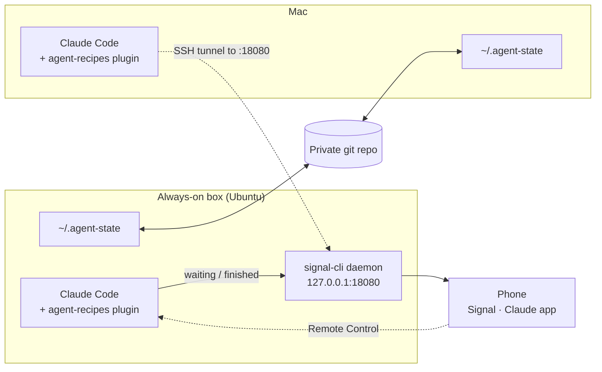

# Tutorial — notifications, sync and remote access

By the end you will have:

- the **safety guard** active from the plugin alone, on every device;
- a **Signal message** on your phone when Claude Code is waiting for you or has finished
  a long task;
- **agent memory and your personal `CLAUDE.md`** following you between machines;
- a way to **answer from your phone or Mac** when a session on another machine needs you.



Everything except the guard is opt-in. Do the sections in order; sections 1–4 each
end with a check.

| Section | Time | Needs |
|---------|------|-------|
| 1. Install or update the plugin | 2 min per device | Claude Code, `python3`, `git`, `bash` |
| 2. The guard | 1 min | — |
| 3. Signal notifications | 20–30 min once | A phone with Signal; ideally a second phone number |
| 4. Sync across devices and tools | 5 min, then 1 min per device | A clone of this repo; a private git repository (optional) |
| 5. Autonomous mode | 1 min | — |
| 6. Phone and Mac access | 5 min | A Claude Pro, Max, Team or Enterprise plan |
| 7. The same skills in Hermes or Codex | 2 min | A clone of this repo |

Written against Claude Code 2.1.295 and signal-cli 0.14.9 (agent-recipes 0.5.0).

---

## 1. Install or update the plugin (every device)

New install, inside Claude Code:

```text
/plugin marketplace add wojciechkpl/agent-recipes
/plugin install agent-recipes@agent-recipes
```

Already installed — from a terminal:

```bash
claude plugin marketplace update agent-recipes
claude plugin update agent-recipes@agent-recipes
```

Restart Claude Code afterwards.

**Check.** `claude plugin list` shows `agent-recipes@agent-recipes`, version `0.5.0`,
enabled.

Options are set in either of two ways. Both need a restart to take effect.

```text
/plugin configure agent-recipes@agent-recipes
```

```bash
claude plugin configure agent-recipes@agent-recipes          # show options
echo '{"guard_mode":"always"}' \
  | claude plugin configure agent-recipes@agent-recipes --values-stdin   # set some
```

Options you leave unset keep their defaults. The full list is in §10.

---

## 2. The guard

Nothing to set up. From 0.5.0 the plugin itself runs the guard on every `Bash` and
`Read` call. It stops a short list of dangerous operations: reading private keys and
`.env` files, `rm -rf` on a root or home path, `find -delete`, force-push,
`git reset --hard`, `git clean -fdx`, `sudo`, `curl … | sh`, `mkfs`, `dd` to a device.

What "stops" means depends on the `guard_mode` option:

| `guard_mode` | Session asks before running commands (`default`, `plan`) | Session runs commands without asking (`acceptEdits`, `auto`, `dontAsk`, bypass) |
|--------------|----------------------------------------------------------|----------------------------------------------------------------------------------|
| `auto` (default) | You get a permission prompt with the guard's reason — even if an allow rule would have let the command through | Blocked |
| `always` | Blocked | Blocked |
| `off` | Not checked | Not checked |

**Check.** In a scratch directory:

```bash
mkdir -p /tmp/guard-check && cd /tmp/guard-check && echo 'X=1' > .env && claude
```

Ask Claude to run `cat .env`. In a normal session you are asked, and the prompt names
the guard. Start again with `claude --permission-mode acceptEdits`: this time the
command is blocked and Claude reports `BLOCKED by autonomous-mode guard`.

**If you turned autonomous mode on from a clone before** (`claude/autonomous-mode.sh on`):
your `settings.json` still has the old absolute-path hook. That one always blocks, so
`guard_mode` has no visible effect while it is there. Run `/autonomous-mode on` once —
with `--project` if that is how you enabled it — and the old entry is removed.

The guard is a seatbelt, not a sandbox. It cannot see what a program does once it is
running. For real isolation on an unattended machine, run the agent in a container or
under its own OS user.

---

## 3. Signal notifications

You run a small local service, **signal-cli**, that can send Signal messages. The plugin
calls it when a session needs you.

> **Fast path.** One script does 3.2 to 3.7 for you — install, identity, a message by
> hand, the daemon as a launchd agent or systemd user unit, the plugin options, and a
> test through the plugin. From a clone of this repo:
>
> ```bash
> claude/scripts/signal-setup.sh --account +48BOTNUMBER --recipient +48YOURNUMBER   # path A
> claude/scripts/signal-setup.sh --mode link --account +48YOURNUMBER                 # path B
> ```
>
> It asks for the SMS verification code on path A, prints the QR code on path B, never
> uses `sudo`, and ends with "restart Claude Code". `--dry-run` shows every command
> first; `--status` reports what is installed, registered, running and configured;
> `--uninstall` stops the daemon and turns notifications off. Read 3.1 first — the
> choice of a dedicated number versus linking your own account is the one decision the
> script cannot make for you.

### 3.1 Choose how signal-cli gets a Signal identity

| | **A — dedicated number** (recommended) | **B — link to your own account** |
|---|---|---|
| What it is | signal-cli registers a second phone number as its own Signal account and messages you from it | signal-cli becomes a "linked device" on your personal account, like Signal Desktop |
| Needs | A number that can receive one SMS or call (prepaid SIM, landline, VoIP) | Just your phone |
| Phone alert | A normal incoming message: it buzzes | A message from yourself to yourself: may arrive silently |
| What the machine can access | Only the bot account | **All your Signal conversations**, and it can send as you |
| Use it on | Any machine, and always on a box where agents run unattended | A personal laptop only |

The daemon has no password. Any program on that machine — including an agent — can ask
it to send or read messages for the account it holds. That is why a machine that runs
agents unattended should hold a bot account and never your personal one.

### 3.2 Install signal-cli

Ubuntu (native build, no Java needed):

```bash
VERSION=$(curl -Ls -o /dev/null -w %{url_effective} https://github.com/AsamK/signal-cli/releases/latest | sed -e 's/^.*\/v//')
curl -L -O https://github.com/AsamK/signal-cli/releases/download/v"${VERSION}"/signal-cli-"${VERSION}"-Linux-native.tar.gz
sudo tar xf signal-cli-"${VERSION}"-Linux-native.tar.gz -C /opt
sudo ln -sf /opt/signal-cli /usr/local/bin/
signal-cli --version
```

macOS:

```bash
brew install signal-cli
```

Run these yourself in a terminal. They use `sudo`, which the guard stops Claude from
running.

### 3.3 Give it an identity

**Path A — dedicated number.** Replace `+15550001111` with the bot's number, in
international format.

```bash
signal-cli -a +15550001111 register            # add --voice for a landline
signal-cli -a +15550001111 verify 123456       # the code you received
signal-cli -a +15550001111 updateProfile --given-name "Claude Code"
```

If `register` answers that a captcha is required, follow
[Registration with captcha](https://github.com/AsamK/signal-cli/wiki/Registration-with-captcha)
and run it again with `--captcha`.

**Path B — link to your own account.**

```bash
signal-cli link -n "claude-notify"
```

A QR code appears in the terminal. On your phone: Signal → Settings → Linked devices →
Link new device, and scan it.

### 3.4 Send one message by hand

```bash
# Path A: from the bot to your own number
signal-cli -a +15550001111 send -m "hello from signal-cli" +15551234567

# Path B: from your account to yourself, as a normal message
signal-cli -a +15551234567 send --notify-self -m "hello from signal-cli" +15551234567
```

**Check.** The message arrives. On path A, Signal shows a message request the first
time: accept it, or later messages stay hidden. On path B, if your phone stays silent,
that is the limit of linking — switch to path A if you want an audible alert.

### 3.5 Run the daemon

The plugin talks to `http://127.0.0.1:18080/api/v1/rpc`. Use the account from 3.3.

**Ubuntu** — `~/.config/systemd/user/signal-cli.service`:

```ini
[Unit]
Description=signal-cli JSON-RPC daemon for agent-recipes notifications
After=network-online.target
Wants=network-online.target

[Service]
ExecStart=/usr/local/bin/signal-cli -a +15550001111 daemon --http 127.0.0.1:18080 --no-receive-stdout --ignore-attachments --ignore-stories
Restart=on-failure
RestartSec=10

[Install]
WantedBy=default.target
```

```bash
systemctl --user daemon-reload
systemctl --user enable --now signal-cli
loginctl enable-linger "$USER"      # keep it running when you are logged out
```

**macOS** — `~/Library/LaunchAgents/org.signal-cli.daemon.plist`:

```xml
<?xml version="1.0" encoding="UTF-8"?>
<!DOCTYPE plist PUBLIC "-//Apple//DTD PLIST 1.0//EN" "http://www.apple.com/DTDs/PropertyList-1.0.dtd">
<plist version="1.0">
<dict>
  <key>Label</key><string>org.signal-cli.daemon</string>
  <key>ProgramArguments</key>
  <array>
    <string>/opt/homebrew/bin/signal-cli</string>
    <string>-a</string><string>+15550001111</string>
    <string>daemon</string>
    <string>--http</string><string>127.0.0.1:18080</string>
    <string>--no-receive-stdout</string>
    <string>--ignore-attachments</string>
    <string>--ignore-stories</string>
  </array>
  <key>RunAtLoad</key><true/>
  <key>KeepAlive</key><true/>
</dict>
</plist>
```

```bash
launchctl load -w ~/Library/LaunchAgents/org.signal-cli.daemon.plist
```

Keep the address at `127.0.0.1`. Never bind it to `0.0.0.0`.

**Check.**

```bash
curl -s -o /dev/null -w '%{http_code}\n' http://127.0.0.1:18080/api/v1/check    # 200
```

### 3.6 Turn notifications on

```bash
echo '{"notify_enabled":"true","notify_recipient":"+15551234567"}' \
  | claude plugin configure agent-recipes@agent-recipes --values-stdin
```

`notify_recipient` is the number that should be alerted: yours. Restart Claude Code.

### 3.7 Test

Inside Claude Code:

```text
/notify-test
```

**Check.** Claude reports `OK  sent` and your phone shows
`[hostname] agent-recipes: test notification`.

### 3.8 What you will receive

| When | Message |
|------|---------|
| Claude asks for permission, asks you a question, or has been idle waiting for input | `[box] my-project: waiting — Claude needs your permission to use Bash` |
| A turn that ran for two minutes or more ends | `[box] my-project: finished after 14m32s` |

This works for headless runs too (`claude -p "…"` from cron or a script).

Tuning:

| Option | Effect |
|--------|--------|
| `notify_min_seconds` | Shortest turn that earns a "finished" message. Default 120; `0` means every turn, at most one message per 30 seconds. |
| `notify_include_summary` | Adds the first 200 characters of Claude's last message. Off by default: it can contain code or data, and it will sit on your lock screen. |

You will not get two messages for one event: an idle reminder right after a "finished"
message is dropped, and repeats within 30 seconds are suppressed.

### 3.9 More than one machine

Each machine's plugin needs to reach a daemon. Run **one** daemon, on the always-on box,
and let the others borrow it through an SSH tunnel — the port stays private and nothing
else needs configuring:

```bash
ssh -f -N -L 18080:127.0.0.1:18080 box
```

Or permanently, in `~/.ssh/config` on the Mac:

```text
Host box
    LocalForward 18080 127.0.0.1:18080
```

Then do 3.6 and 3.7 on the Mac. Messages name the machine they came from.

If the machines share a private network such as Tailscale, you can instead set
`notify_signal_rpc_url` to the box's private address and `notify_allow_remote` to
`true`, and bind the daemon to that private address. The traffic is plain HTTP and the
daemon has no password, so do this only on a network you fully control.

---

## 4. Sync across devices — and across tools

> The long form of this section, with every command and its output, is
> [TUTORIAL-state-store.md](TUTORIAL-state-store.md).

Agent memory and your instruction files live in one **state store**: a private git
repository (default `~/.agent-state`) that every device pulls when a session starts and
pushes when it ends. It holds the memory of every tool you use, each in its own folder,
and **one shared instruction file** that all of them read:

| Tool | What is linked into the store | Where in the store |
|------|-------------------------------|--------------------|
| Claude Code | `~/.claude/agent-memory/` (the agents with `memory: user`) | `claude/agent-memory/` |
| | `~/.claude/projects/<project>/memory/` (the assistant's own notes, per project) | `claude/auto-memory/<project>/` |
| | `~/.claude/CLAUDE.md` | `INSTRUCTIONS.md` |
| Goose | `~/.config/goose/memory/` | `goose/memory/` |
| | `~/.config/goose/.goosehints` | `INSTRUCTIONS.md` |
| Hermes | `~/.hermes/memories/` | `hermes/memories/` |
| Codex | `~/.codex/AGENTS.md` | `INSTRUCTIONS.md` |

No tool reads another tool's memory — the formats differ — so cross-tool memory is the
`shared/` folder: `INSTRUCTIONS.md` ends with a fixed paragraph telling every assistant
to read `shared/*.md` for durable facts about your work and to add a short Markdown
file there when it learns one. Codex's own memory store is not synced: it keeps a git
repository of its own inside, which cannot nest. Hermes keeps `SOUL.md` (an identity
file, not instructions).

### 4.1 Choose where it lives — `setup.sh --state`

From a clone of this repo, on a terminal:

```bash
./setup.sh --state        # included in --all; --no-state skips it
```

It asks four things: where the store lives (Enter = `~/.agent-state`), which private
remote syncs it (Enter = this machine only, still with history), which of the detected
tools to include (Claude is always in), and whether Claude's per-project notes join.
The answers go to `~/.config/agent-recipes/state.conf`, which the plugin's hooks, the
`/sync-state` command and `setup.sh` all read, so they can never disagree about the
directory. Flags do the same without questions: `--state-dir`, `--state-remote`,
`--state-tools "claude goose"`; `--dry-run` shows the config and the links it would make.

Without a clone, inside Claude Code: `/sync-state config dir=… remote=… tools=…`.

### 4.2 The remote

```bash
gh repo create agent-state --private
```

It must be private, on an account only you control, with two-factor authentication on.
Whoever can write to it can change the instructions every tool follows on all your
devices. Make sure git reaches it without asking anything — hooks cannot answer prompts:

```bash
git ls-remote git@github.com:YOUR-USER/agent-state.git      # must not prompt
```

### 4.3 First device

`setup.sh --state` runs `init` for you; from inside Claude Code it is:

```text
/sync-state init                      # uses the configured remote, or local-only
/sync-state init git@github.com:YOUR-USER/agent-state.git
```

Your existing memory directories move into the store and are replaced by symlinks.
`INSTRUCTIONS.md` is built from `~/.claude/CLAUDE.md`; a `.goosehints` or `AGENTS.md`
that says something different is folded in under a `## From goose` / `## From codex`
heading and the original kept in `~/.claude/.state-sync-backup/<timestamp>/`. Review
the result once — it is now what every tool follows.

**Coming from 0.5.0?** A `~/.agent-state` is moved to the configured location and its
layout converted, history kept, links re-pointed. Nothing to do by hand.

> **Known limit — Cowork.** Claude Code's docs say that Cowork sessions (the desktop
> app) skip a `~/.claude/CLAUDE.md` that is a symlink. The terminal CLI honours it. On
> a machine where you also use Cowork, keep a plain copy there or accept that Cowork
> sessions do not see the synced file; agent memory is unaffected.

### 4.4 Every other device

`./setup.sh --state` (or `/sync-state init`) with the same remote. A tool that is not
installed there is simply not linked; its folder rides along in the repo. If the device
already has memory of its own, files that exist only there are added; where both sides
have the same file the repository's version is used, and the device's old copy is kept
in `~/.claude/.state-sync-backup/<timestamp>/`.

**Check.**

```text
/sync-state status
```

shows `state sync: ON`, the tools in play, one `linked` line per item, and the
repository address (or `local-only`).

### 4.5 Day to day

Nothing to do.

- **Session start:** local edits are committed, then the latest state is pulled. If
  the shared instructions changed on another device, Claude is told to re-read them. A
  Claude project you opened for the first time is picked up at the next session start.
- **Session end:** changes are committed and pushed in the background.
- **Offline:** changes are committed locally and go out next time.
- **Both devices edited the same file:** Markdown and Goose's `.txt` categories keep
  both sets of lines. For any other file the device that syncs second wins.
- **Hermes:** its two memory files have hard size caps; after a merge pushes one over,
  `status` warns and Hermes' next write would fail until you trim it.

`/sync-state push` and `/sync-state pull` do it on demand — useful before closing a
laptop.

### 4.6 What is never synced

Settings of any tool, credentials and tokens, sessions and transcripts, Codex's memory
store, project-level memory (`.claude/agent-memory/` inside a repository travels with
that repository if you commit it).

Files that look like secrets — by name (`.env`, `id_rsa`, `*.pem`, …) or by content (a
private-key header, an AWS, GitHub, Anthropic or Slack token) — are held back, and
`/sync-state status` lists them. That check is pattern-based and will not catch
everything, so look at what the repository contains from time to time:

```bash
git -C ~/.agent-state log --stat -5
```

The store now also carries Hermes' `USER.md` (a profile of you) — one more reason the
repository stays private.

### 4.7 Turn it off on a device

```text
/sync-state off
```

Every link becomes an ordinary file or directory again, with its current content, and
this device stops syncing. The store is left alone; `/sync-state init` turns sync back
on. `./setup.sh --uninstall` does the same and removes `state.conf`.

---

## 5. Autonomous mode with the plugin

```text
/autonomous-mode on          # or: off | status   (add --project for this repo only)
```

`on` switches to `acceptEdits` and adds the development allow-list and deny-list, as
before. The guard is now the plugin's own hook rather than a path written into your
settings, so it keeps working across plugin updates. Restart Claude Code after toggling.

Run `/autonomous-mode off` **before** you disable or uninstall the plugin. Otherwise the
broad permissions remain and the guard is gone.

For a machine that works unattended, consider `guard_mode: always`.

---

## 6. Reaching a session from your phone or Mac

Signal tells you that a session needs you. **Remote Control**, a Claude Code feature,
lets you answer from wherever you are. It needs a Pro, Max, Team or Enterprise plan
(not an API key).

On the box, in `tmux` so it survives your SSH session:

```bash
tmux new -s claude
cd ~/work/my-project
claude remote-control --name box
```

or inside a session that is already running: `/remote-control`.

Then open [claude.ai/code](https://claude.ai/code) or the Claude app on your phone and
pick the session. You see the conversation and can reply and approve.

The Claude app can also send its own push notifications (`/config` in Claude Code, the
push settings). Signal and those pushes overlap. Signal also covers headless jobs
(`claude -p` from cron or a script), which have no session to open in the app.

A typical loop:

1. Start a long task on the box and walk away.
2. Signal: `[box] my-project: waiting — Claude needs your permission to use Bash`.
3. Open the Claude app, read the request, approve or redirect.
4. Signal: `[box] my-project: finished after 41m07s`.

---

## 7. The same skills in Hermes or Codex

Hermes Agent can read this repo's skills in place. Clone the repo on the machine that
runs Hermes, then add to `~/.hermes/config.yaml`:

```yaml
skills:
  external_dirs:
    - ~/src/agent-recipes/claude/skills
```

Hermes treats external directories as read-only. Two limits: `allowed-tools` in a
skill's frontmatter means something only to Claude Code, and a skill that tells the
model to use Claude Code's `Skill` or `Agent` tool needs that line adapted before it is
useful elsewhere.

**Codex** (OpenAI) reads the same format with no configuration: it scans
`$HOME/.agents/skills` and `<repo>/.agents/skills` for `SKILL.md` files, requires only
`description` (`name` falls back to the directory name) and ignores `allowed-tools`.
A symlink is enough:

```bash
mkdir -p ~/.agents/skills
for s in ~/src/agent-recipes/claude/skills/*/; do ln -sfn "$s" ~/.agents/skills/; done
```

Limits from Codex's loader: `name` ≤ 64 characters, `description` ≤ 1024, and the same
`Skill`/`Agent` caveat as Hermes. (Checked against
[learn.chatgpt.com/docs/build-skills](https://learn.chatgpt.com/docs/build-skills.md)
and the `openai/codex` parser on 2026-10-09; the older `~/.codex/skills` location still
works but is marked deprecated.)

---

## 8. Troubleshooting

| Symptom | Check | Fix |
|---------|-------|-----|
| No message at all | `/notify-test` | Read its `FAIL` line, below |
| `FAIL URLError … Connection refused` | `curl -s -o /dev/null -w '%{http_code}\n' http://127.0.0.1:18080/api/v1/check` | Start the daemon (`systemctl --user status signal-cli`, `journalctl --user -u signal-cli -n 50`); on a second machine, open the SSH tunnel (3.9) |
| `FAIL signal-cli error …` | The text after it | Account not registered or linked (3.3); recipient not in international format |
| `FAIL … non-loopback` | `notify_signal_rpc_url` | Use the SSH tunnel, or set `notify_allow_remote` knowingly (3.9) |
| `/notify-test` works, sessions send nothing | `notify_enabled`; was Claude Code restarted? | Set it to `true`, restart |
| No "finished" message | Was the turn shorter than `notify_min_seconds`? | Lower it |
| Messages arrive without a sound | Path B, or the bot's chat is muted | Unmute; otherwise move to path A |
| What did the notifier do? | `~/.claude/plugins/data/agent-recipes-agent-recipes/notify/notify.log` | — |
| The guard stopped something you wanted | The reason in the message | Run it yourself (`! command` in the prompt), or rephrase. Do not turn the guard off for one command |
| The guard seems to run twice | Old absolute-path hook in `settings.json` | `/autonomous-mode on` once |
| Sync is not happening | `/sync-state status`, then `~/.agent-state/.sync.log` | `FETCH FAILED`: network or credentials — `git -C ~/.agent-state fetch` must work without a prompt |
| A memory file is missing on other devices | `/sync-state status` lists it as held back | Remove the secret from it, or rename it if only the name looked like one; it syncs next time |
| `REBASE FAILED` in the sync log | `git -C ~/.agent-state status` | `git -C ~/.agent-state pull --rebase`, resolve the conflict, `git rebase --continue`, then `/sync-state push` |
| A device has an old `CLAUDE.md` | Did a session start since the change? | `/sync-state pull` |
| A plugin update changed nothing | `claude plugin list` | `claude plugin marketplace update agent-recipes`, `claude plugin update agent-recipes@agent-recipes`, restart |

---

## 9. Removing things

In this order:

1. `/autonomous-mode off` — while the plugin is still installed.
2. `/sync-state off` on each device. Delete `~/.agent-state/` and the repository if you
   no longer want them.
3. `echo '{"notify_enabled":"false"}' | claude plugin configure agent-recipes@agent-recipes --values-stdin`
4. Stop the daemon: `systemctl --user disable --now signal-cli` (Ubuntu) or
   `launchctl unload -w ~/Library/LaunchAgents/org.signal-cli.daemon.plist` (macOS).
5. Path B only: on your phone, Signal → Settings → Linked devices → remove
   `claude-notify`.
6. `/plugin uninstall agent-recipes@agent-recipes`

---

## 10. Reference

**Plugin options**

| Option | Default | Meaning |
|--------|---------|---------|
| `guard_mode` | `auto` | `auto`, `always` or `off` — see §2 |
| `notify_enabled` | `false` | Send Signal notifications |
| `notify_recipient` | empty | Number or username to alert. Empty means Note to Self, which is silent |
| `notify_signal_account` | empty | Only if one daemon serves several accounts |
| `notify_signal_rpc_url` | `http://127.0.0.1:18080/api/v1/rpc` | Where the daemon listens |
| `notify_min_seconds` | `120` | Shortest turn that earns a "finished" message |
| `notify_include_summary` | `false` | Add 200 characters of Claude's last message |
| `notify_allow_remote` | `false` | Allow a daemon that is not on this machine |

**Commands**

| Command | Does |
|---------|------|
| `/notify-test` | Sends a test message with your current options |
| `/sync-state init [git-url]` · `status` · `pull` · `push` · `off` · `config …` | Cross-device, cross-tool sync of memory and instructions |
| `/autonomous-mode on` · `off` · `status` `[--project]` | Broad-but-guarded permissions |

**Where things live**

| Path | What |
|------|------|
| `~/.agent-state/` (or your `STATE_DIR`) | The state store; `.sync.log` inside it; `~/.config/agent-recipes/state.conf` says where it is |
| `~/.claude/.state-sync-backup/` | Copies set aside when a device joined |
| `~/.claude/plugins/data/agent-recipes-agent-recipes/notify/` | Notifier state and `notify.log` |
| `~/.local/share/signal-cli/` | signal-cli's account data — treat it like a password |

**Sources:** [signal-cli](https://github.com/AsamK/signal-cli) ·
[signal-cli man page](https://github.com/AsamK/signal-cli/blob/master/man/signal-cli.1.adoc) ·
[Homebrew formula](https://formulae.brew.sh/formula/signal-cli) ·
[Claude Code hooks](https://code.claude.com/docs/en/hooks) ·
[Claude Code plugins reference](https://code.claude.com/docs/en/plugins-reference) ·
[Claude Code remote control](https://code.claude.com/docs/en/remote-control)
