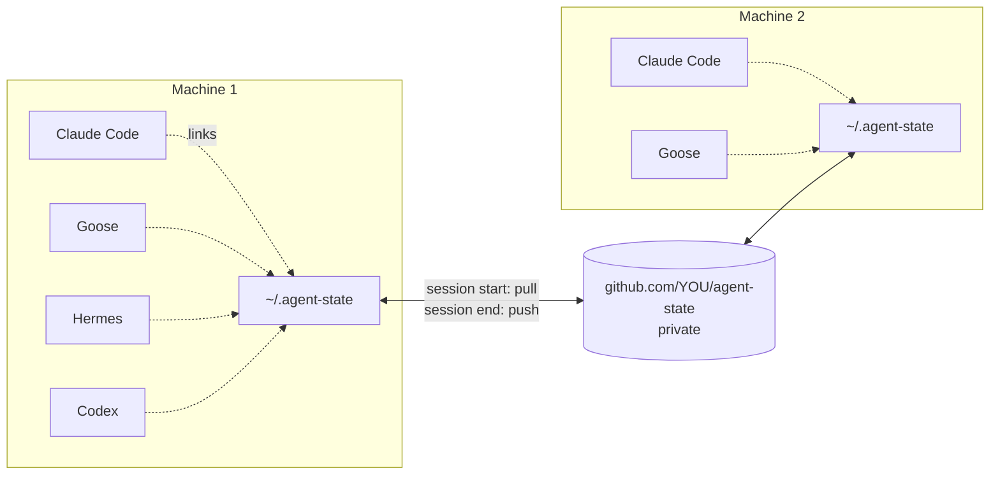
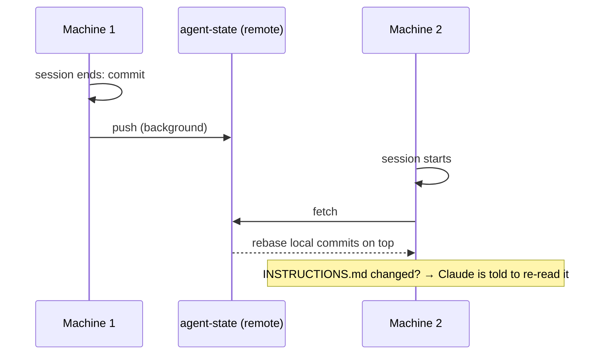

# Tutorial — one memory store for every agent, on every machine

Step by step, from a single laptop to several machines sharing one private store of
agent memory and instructions for Claude Code, Goose, Hermes and Codex. Every command
below was run on a real machine; the outputs are abridged from that run.

Written against agent-recipes 0.6.0 and Claude Code 2.1.295.



| Step | What you get | Time |
|------|--------------|------|
| 1 | The store on this machine, local-only | 2 min |
| 2 | A private remote; the store pushed | 3 min |
| 3 | Every other machine joined | 2 min each |
| 4 | Notes every tool reads and writes | ongoing |
| 5 | Day-to-day: nothing to do, and how to check | — |
| 6 | Turning it off, moving it, removing it | — |

**Prerequisites.** A clone of this repo, `git`, `python3`, and `bash`. The
agent-recipes plugin installed in Claude Code (`/plugin install agent-recipes@agent-recipes`)
so the session hooks run; Goose, Hermes and Codex are optional and detected.

---

## Step 1 — the store on this machine

From the clone, on a terminal:

```bash
./setup.sh --state
```

It detects the tools present and asks four questions. Enter keeps the default:

```text
State store — one private git repo for agent memory and instructions.
Detected tools: claude goose hermes codex

Where should agent memory and instructions live? [/Users/you/.agent-state]
Private git remote to sync it (Enter = this machine only):
Include goose? [Y/n]
Include hermes? [Y/n]
Include codex? [Y/n]
Also sync Claude's per-project auto memory (~/.claude/projects/*/memory)? [Y/n]
```

Leave the remote empty for now: the store works on one machine, with history, and
Step 2 attaches a remote later. Then it links each tool's files into the store:

```text
[ok]    Wrote /Users/you/.config/agent-recipes/state.conf
  linked /Users/you/.claude/agent-memory -> /Users/you/.agent-state/claude/agent-memory
  linked /Users/you/.claude/CLAUDE.md -> /Users/you/.agent-state/INSTRUCTIONS.md
  linked /Users/you/.config/goose/memory -> /Users/you/.agent-state/goose/memory
  linked /Users/you/.config/goose/.goosehints -> /Users/you/.agent-state/INSTRUCTIONS.md
  linked /Users/you/.hermes/memories -> /Users/you/.agent-state/hermes/memories
  linked /Users/you/.codex/AGENTS.md -> /Users/you/.agent-state/INSTRUCTIONS.md
  linked /Users/you/.claude/projects/-Users-you-work-myproject/memory -> …/claude/auto-memory/-Users-you-work-myproject
  …
state sync is ON (local-only, no remote): /Users/you/.agent-state
[ok]    State store ready at /Users/you/.agent-state (tools: claude goose hermes codex)
```

What happened:

- Your memory directories **moved** into the store and a symlink was left in their
  place. Every tool keeps reading and writing its usual path.
- Your `~/.claude/CLAUDE.md` became `INSTRUCTIONS.md` in the store. Goose's
  `.goosehints` and Codex's `AGENTS.md` now point at the same file. If one of them
  existed and said something different, its text was folded in under a
  `## From goose` or `## From codex` heading and the original kept in
  `~/.claude/.state-sync-backup/<timestamp>/` — read `INSTRUCTIONS.md` once now, it is
  what every tool follows.
- A fixed paragraph was appended at the end of `INSTRUCTIONS.md` (Step 4).
- The first commit was made. Nothing left the machine.

Not in the mood for questions? Flags do the same: `--state-dir`, `--state-remote`,
`--state-tools "claude goose"`, and `--dry-run` shows what would be linked without
touching anything.

**Check.**

```bash
claude/scripts/state-sync.sh status
```

```text
state sync: ON  /Users/you/.agent-state (local-only, no remote)
tools: claude goose hermes codex
  linked    claude/agent-memory  <- /Users/you/.claude/agent-memory
  linked    INSTRUCTIONS.md  <- /Users/you/.claude/CLAUDE.md
  …
## main
recent log:
  2026-10-10T14:48:21Z committed local changes
```

Inside Claude Code the same is `/sync-state status`.

---

## Step 2 — a private remote

```bash
gh repo create agent-state --private
```

Private, on an account only you control, with two-factor authentication on: whoever
can write to this repository can change the instructions every tool follows on all
your machines. Then make sure git reaches it **without prompting** — hooks cannot
answer questions:

```bash
git ls-remote git@github.com:YOU/agent-state.git      # must print refs, not ask
```

Record the remote and push:

```bash
claude/scripts/state-sync.sh config remote=git@github.com:YOU/agent-state.git
claude/scripts/state-sync.sh init
```

```text
state sync is ON: /Users/you/.agent-state -> git@github.com:YOU/agent-state.git
Keep that repository PRIVATE: agent memory can contain details of your work.
```

(Or answer the remote question in Step 1 and skip this.) **Check:** the repository on
GitHub has one commit, and `status` now shows the remote instead of `local-only`.

---

## Step 3 — every other machine

On each other machine, clone agent-recipes and run:

```bash
./setup.sh --state --state-remote git@github.com:YOU/agent-state.git
```

(or answer the remote question). The store is cloned, the tools present there are
linked, and:

- memory that exists only on this machine is **added** to the store;
- where both sides have the same file, the **store's version wins** and the machine's
  old copy goes to `~/.claude/.state-sync-backup/<timestamp>/`;
- a tool that is not installed here is simply not linked; its folder rides along.

```text
  merged claude/agent-memory: local-only files added, the repo's version replaced yours on collisions (your previous copy: /Users/you/.claude/.state-sync-backup/20261010T150102Z/agent-memory)
  replaced your CLAUDE.md with the repo's INSTRUCTIONS.md (your previous copy: …/.state-sync-backup/20261010T150102Z/CLAUDE.md)
  linked /Users/you/.claude/CLAUDE.md -> /Users/you/.agent-state/INSTRUCTIONS.md
```

If that machine had its own `CLAUDE.md` with rules you want to keep, copy the lines
from the backup into `INSTRUCTIONS.md` now; the next session end pushes them
everywhere.

**Check.** `status` shows the remote and `## main...origin/main`; a memory file written
on machine 1 is readable on machine 2 after one session start.



---

## Step 4 — notes every tool reads and writes

No tool reads another tool's memory: Goose keeps plain-text categories, Hermes two
capped files, Claude per-agent trees. The bridge is the `shared/` folder in the store
and the paragraph at the end of `INSTRUCTIONS.md`, which tells every assistant:

> Durable facts about this user's work that any assistant may need live in the
> `shared/` folder … Read them at the start of a task that needs context … When you
> learn something durable, add a short Markdown file there … Never store secrets there.

So the convention is simply: one short Markdown file per topic. Seed it yourself with
the things you keep repeating to every tool:

```bash
cat > ~/.agent-state/shared/projects.md <<'EOF'
# Projects

- **RiseRally** — Flutter app, Riverpod, `~/Sync/work/RiseRally`; CI on GitHub Actions.
- **rlox** — Rust interpreter, `~/Sync/work/rlox-workspace`; use `cargo nextest`.
EOF
cat > ~/.agent-state/shared/preferences.md <<'EOF'
# How I like to work

- Conventional commits, no AI co-author trailers.
- Plans as Markdown files with Mermaid diagrams, never only in chat.
EOF
```

Tool-specific lines go under a heading named for the tool (`## Claude Code`,
`## Goose`, `## Codex`); the paragraph tells the others to skip them. The next
session end commits and pushes the notes like everything else.

---

## Step 5 — day to day

Nothing. Session start pulls, session end commits and pushes; a project you open for
the first time in Claude Code is adopted at the next session start. When the shared
instructions changed on another machine, the session's first line says so:

```text
state-sync: /Users/you/.claude/CLAUDE.md was updated from another device during startup (it is the shared INSTRUCTIONS.md). Read that file now; …
```

Two machines editing the same file: Markdown and Goose's `.txt` categories keep both
sets of lines; for anything else the machine that syncs second wins. Offline edits are
committed locally and go out next time.

**When something looks off**

| Symptom | Check | Fix |
|---------|-------|-----|
| `status` says `missing` for an item | the link was removed by hand | `/sync-state init` relinks |
| `FETCH FAILED` in the log | `git -C ~/.agent-state fetch` prompts or fails | fix SSH/credentials; the local commit waits |
| `REBASE FAILED` in the log | `git -C ~/.agent-state status` | resolve as in any repo, then `/sync-state push` |
| A memory file is missing on other machines | `status` lists it under *held back* | it looks like a secret; remove the secret or rename the file |
| `WARNING hermes/memories/MEMORY.md is 2310 chars, over Hermes' limit of 2200` | a merge grew it | trim it; Hermes refuses to write until you do |
| Cowork sessions ignore your `CLAUDE.md` | it is a symlink; Cowork skips those (documented) | keep a plain copy there, or accept it; the CLI is fine |
| Goose or Hermes keep their files elsewhere | `GOOSE_PATH_ROOT`, `HERMES_HOME`, `CODEX_HOME`, `CLAUDE_CONFIG_DIR` | the scripts honour those variables; run them in that environment |

The log is `~/.agent-state/.sync.log`; `status` prints its last five lines.

---

## Step 6 — off, elsewhere, gone

**Off on one machine:** `/sync-state off`. Every link becomes a plain copy; the store
stays; `/sync-state init` turns it back on and a file you edited meanwhile wins.

**A different directory:** `state-sync.sh config dir=/Volumes/Work/agent-state`
then `init`; an existing store is moved. Coming from 0.5.0's `~/.claude-state`? It is
detected, moved and converted on the next `init` by itself.

**Fewer tools:** `state-sync.sh config tools="claude goose"` then `init`.

**Gone:** `./setup.sh --uninstall` restores plain copies and removes
`~/.config/agent-recipes/state.conf`; delete `~/.agent-state` and the GitHub repository
yourself if you no longer want them.

---

## Reference

**`~/.config/agent-recipes/state.conf`** — written by `setup.sh --state` or
`state-sync.sh config`, read by the hooks, `/sync-state` and `setup.sh`:

```sh
STATE_DIR="/Users/you/.agent-state"
STATE_REMOTE="git@github.com:YOU/agent-state.git"
STATE_TOOLS="claude goose hermes codex"
STATE_CLAUDE_AUTO_MEMORY="yes"
```

**Commands** (`claude/scripts/state-sync.sh …` from a clone, `/sync-state …` inside
Claude Code):

| Command | Does |
|---------|------|
| `config [dir=… remote=… tools=… auto_memory=yes\|no]` | show or write `state.conf` |
| `init [git-url]` | clone or create the store, adopt and link, first push (no URL: the configured remote, or local-only) |
| `status` | tools, links, remote, warnings, held-back files, recent log |
| `pull` · `push` | what the hooks run; silent, never fail a session |
| `off` | plain copies back, hooks stop on this machine |
| `items` · `detect` | what `init` would link · which tools are detected |

**What is never synced:** settings of any tool, credentials and tokens, sessions and
transcripts, Codex's own memory store (it carries a git repository of its own), and
anything whose name or content looks like a secret.
