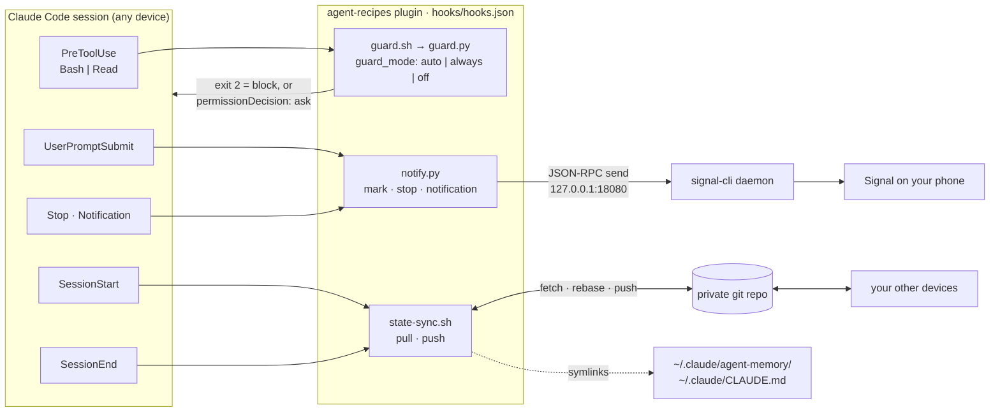

# Phase 4 plan — plugin-native guard, Signal notifications, cross-device sync

**Date:** 2026-10-08 · **Base:** `54a5da4` (plugin 0.4.0) · **Target:** plugin 0.5.0

> **Status: implemented** (all seven tracks, 2026-10-09, branch `phase-4`, plugin
> 0.5.0; U1 = yes, U2 = default yes). One commit per track plus one for the
> pre-existing toggle work the branch was built on and one for review regression
> tests; `docs/phase-4-reference/` removed. Deviations from this document:
>
> - **D4 and the toggle's backup logic.** The uncommitted toggle work found in the
>   tree recognised an autonomous state by the guard hook in `settings.json`; with
>   `--plugin` no hook is written, so the fingerprint now also accepts the profile's
>   complete allow-list (regression test in `tests/test_plugin_guard.sh`).
> - **D10, state sync.** A secret appended to an *already tracked* file is held back
>   as an unstaged change, which made `git rebase` refuse and stalled the device in
>   both directions (reproduced). The rebase now runs with `--autostash`
>   (`tests/test_state_sync.sh`).
> - **Fact 10, Cowork.** The docs say Cowork sessions skip a symlinked user
>   `CLAUDE.md`; the CLI honours it. Documented as a known limit in the tutorial
>   (§4.2) rather than switching `CLAUDE.md` to copy-based sync.
> - **Track F** keeps the reader rule and adds a quote-aware per-word rule (shlex): a
>   jq filter or stream-editor script that mentions `.env` is not a path and stays
>   allowed; a quoted secret literal inside a program string counts. The 8k-command
>   corpus named in Track F was not available; the 100-check corpus in
>   `tests/test_autonomous_mode.sh` is unchanged and green.
> - **Track E.4, Codex.** Codex loads `SKILL.md` directories natively from
>   `~/.agents/skills` and `<repo>/.agents/skills`, requires only `description`
>   (`name` falls back to the directory) and ignores `allowed-tools`; recorded in the
>   tutorial §7. Nothing to build.
> - **Track D step 4** (a CI job running `claude plugin validate`) was not added: it
>   could not be confirmed to work without credentials on a clean runner.
> - **Probe:** fact 5's `default` check reads whatever `defaultMode` the user's own
>   settings set (`auto` on the implementing machine); pass `--permission-mode
>   default` when re-running it.
>
> **§8 on a real machine:** V4 done (all suites under macOS `/bin/bash` 3.2.57).
> V1 (interactive `Notification` hook), V2 (a live Signal account), V3 (agent memory
> through the symlink) and V5 (the `ask` prompt in an interactive `default` session)
> still need a person at a terminal and are not recorded here.

Beyond the contract tests, the patched plugin was run through the real CLI in headless
mode: guard block, ask and off; a "finished" ping delivered to a stub daemon;
`/notify-test`; `/sync-state init` on two simulated devices with a `CLAUDE.md` change
arriving on the second; a marketplace install configured with `claude plugin
configure`. **Not exercised:** a live Signal account, interactive prompts, agent memory
through the symlink, macOS. Those are the checks in §8.

The plugin becomes self-sufficient: installing it is enough to get the safety guard,
an optional Signal ping when Claude Code needs you or finishes, and optional sync of
agent memory and your user-level `CLAUDE.md` between devices.



---

## 1. How to use this document (implementing agent)

Work in two passes. Do not skip the first one.

### Pass 1 — review, no code changes

1. **Check the base.** `git rev-parse --short HEAD` should be `54a5da4` or a descendant.
   If `claude/hooks/`, `claude/autonomous-mode.sh`, `claude/.claude-plugin/plugin.json`
   or `tests/` changed since, re-read §3 against the current files before trusting any
   line reference here.
2. **Get a baseline.** Run what CI runs today (`.github/workflows/ci.yml`) on the
   untouched tree. Expect green, with one known exception: shellcheck 0.11 or newer
   reports SC2115 at `setup.sh:207` (finding 9; fixed in the patch).
3. **Check the patch.** `git apply --check docs/phase-4-reference/tracks-abc.patch`.
4. **Check the platform facts.** §4 lists what this design relies on and how each fact
   was established. Facts were probed with Claude Code **2.1.293**. If `claude --version`
   differs, run `docs/phase-4-reference/probe-platform-facts.sh`. It re-checks every
   fact marked ★ with four short headless model calls and prints which ones hold.
5. **Report before building:** decisions in §5 you disagree with, facts that no longer
   hold, anything in the patch you would change. Items under §5.2 need the user's
   answer; everything else proceeds on the recommended default.

### Pass 2 — implement

- Tracks in order: **A → B → C → D → E → G**, then **F** only if the user approved it.
- Per track: tests first (take the test files from the patch, run them, see them fail
  for the right reason), then the implementation, then every §11 command whose files
  exist by then. One commit per track
  (§9). `claude/CONVENTIONS.md` applies: TDD, ≤ 400 lines per file, ≤ 30 lines per
  function (50 for Bash), configuration over hard-coding.
- The patch is a reference, not an authority. Where prose here and a test in the patch
  disagree, the test wins; say so in your report.
- **Never let a test reach the real home directory.** Every new test that runs
  `autonomous-mode.sh` or `state-sync.sh` sets `HOME` to a temp dir (see A.5). The
  existing `tests/test_autonomous_mode.sh` stays as it is: it only uses `--project`
  inside a temp directory.
- Do not add a `bin/` directory or an `options` key in `userConfig` (§4, facts 12–13),
  and make no option required: every feature here is opt-in.
- Delete `docs/phase-4-reference/` in the documentation commit (§9, commit 6).

---

## 2. Goals and non-goals

| | Goal | Track |
|---|------|-------|
| G1 | A marketplace install gets the guard with no clone and no absolute path | A |
| G2 | A Signal message when Claude Code is waiting on the user or has finished a long turn, in interactive and headless (`claude -p`) runs | B |
| G3 | Agent memory (`memory: user`) and the user-level `CLAUDE.md` follow the user across devices | C |
| G4 | Manifests and READMEs cannot drift from the tree unnoticed; plugin updates actually reach users | D |
| G5 | The skills are loadable by Hermes without copying them | E |
| G6 | The guard's verified secret-read gaps are closed | F |

**Non-goals.** Two-way control over Signal (use Claude Code Remote Control — tutorial
§6). Syncing settings, credentials, plugins or transcripts. Notifications for Kiro or
Goose. Windows support for the new scripts (Bash, like the rest of the repo). Replacing
`setup.sh`.

---

## 3. Findings in the current tree (`54a5da4`)

| # | Finding | Evidence | Track |
|---|---------|----------|-------|
| 1 | The guard exists only as an absolute-path hook written into `settings.json` by `autonomous-mode.sh`. The plugin ships no `hooks/hooks.json`, so a marketplace install has **no guard**, and an absolute path into the plugin cache would go stale on every update. | `claude/autonomous-mode.sh:62-85`, no `claude/hooks/hooks.json` | A |
| 2 | `/autonomous-mode` runs `claude/autonomous-mode.sh` relative to the working directory. `setup.sh` copies only `wf-*.md` and `wf.md`, so this command exists **only** in plugin installs — where the relative path does not resolve. | `claude/commands/autonomous-mode.md`, `setup.sh` `copy_commands` | A |
| 3 | The toggle takes its scope from `$2` only and ignores unknown flags: `autonomous-mode.sh on --anything` silently runs a **global** `on`. | `claude/autonomous-mode.sh:36-38` | A |
| 4 | `status` creates `.claude/` as a side effect (`mkdir -p "$DIR"` runs before the `case`), and the toggle uses `$HOME/.claude` even when `CLAUDE_CONFIG_DIR` is set. | `claude/autonomous-mode.sh:40-43` | A (optional) |
| 5 | Seven agents declare `memory: user` (ai-researcher and the postgresql, bash, rust, flutter, typescript, python experts). Their memory lives in `~/.claude/agent-memory/<agent>/` and never leaves the device. | `grep -rl 'memory: user' claude/agents` | C |
| 6 | `marketplace.json` advertises "30 specialist agents … 16 … workflows". The tree has 22 agents, 7 skills, 15 `wf-*` commands (`README.md:10` and `claude/README.md:11` are right). | `.claude-plugin/marketplace.json:11` | D |
| 7 | `plugin.json` carries `version`. Claude Code pins an installed plugin to that version, so changes under `claude/` reach nobody until it is bumped. Nothing checks that. | `claude/.claude-plugin/plugin.json` | D |
| 8 | `claude plugin validate .` warns: no marketplace description. | run it | D |
| 9 | shellcheck 0.11.0 reports SC2115 (warning level — the level CI fails on) at `setup.sh:207`. | `shellcheck --severity=warning setup.sh` | fixed in patch |
| 10 | Skills have no `name:` frontmatter. Claude Code infers it from the directory; Hermes requires `name` and `description`. | `claude/skills/*/SKILL.md` | E |
| 11 | The guard's secret rule is "a known reader verb **and** a secret path". Verified to pass (exit 0) at this commit: `jq -R . ~/.aws/credentials` · `git diff --no-index /dev/null .env` · `sort .env` · `while read l; do echo $l; done < .env` · `python3 -c "import pathlib;print(pathlib.Path('.env').read_text())"` · `cat .env .env.example` and `cat .env # see .env.example` (one `.example` anywhere exempts the whole command) · `tar czf /tmp/k.tgz ~/.ssh` (the pattern needs a trailing slash). | `claude/hooks/guard.py:30-60,92` | F |
| 12 | `READER` contains `ssh`, which matches the path `.ssh` itself. Any command naming `~/.ssh/` is therefore blocked today, including `ls -la ~/.ssh/`. Accidental, but conservative — F must not loosen it. | `claude/hooks/guard.py:43-47` | F |
| 13 | README says `--dangerously-skip-permissions` "bypasses the guard too". With the guard as a hook that is not what happens: under `--permission-mode bypassPermissions` the hook ran and blocked (probed live). | `README.md:521` | G |

---

## 4. Platform facts this design relies on

"Live" = observed on 2026-10-08 with Claude Code 2.1.293 in headless mode
(`claude -p … --plugin-dir`, plus one marketplace install into a scratch
`CLAUDE_CONFIG_DIR`). "Docs" = Claude Code documentation or type definitions, not run.
"Source" = read in the signal-cli repository at v0.14.9.

| # | Fact | How |
|---|------|-----|
| 1 ★ | A plugin's `hooks/hooks.json` loads; exec-form hooks (`"command": "sh", "args": [...]`) run with `${CLAUDE_PLUGIN_ROOT}` expanded inside `args`. Hook processes get `CLAUDE_PLUGIN_ROOT`, `CLAUDE_PLUGIN_DATA`, `CLAUDE_PROJECT_DIR`. | Live |
| 2 ★ | A plugin option reaches hook processes as `CLAUDE_PLUGIN_OPTION_<KEY>` **only if the user set it**. A declared `default` is *not* exported. Booleans arrive as `true`, numbers as digits. **Every default therefore lives twice: in `plugin.json` (what `/plugin configure` shows) and in the script (what runs).** | Live |
| 3 ★ | Commands run through the Bash tool get neither `CLAUDE_PLUGIN_ROOT` nor any `CLAUDE_PLUGIN_OPTION_*`. | Live |
| 4 ★ | In a plugin command's Markdown body, `${CLAUDE_PLUGIN_ROOT}`, `${CLAUDE_PLUGIN_DATA}`, `$ARGUMENTS` and `${user_config.KEY}` are substituted as text. `${user_config.KEY}` is substituted **only for options the user set**; otherwise the placeholder stays as literal text. | Live |
| 5 ★ | `PreToolUse` input carries `permission_mode` (`default`, `plan`, `acceptEdits`, `auto`, `dontAsk`, `bypassPermissions`). `SessionStart` input does not. | Live (all six values seen) |
| 6 ★ | `hookSpecificOutput.permissionDecision: "ask"` from a `PreToolUse` hook overrides a matching allow rule. Headless, the call is then denied and the reason shown to Claude. Exit 2 blocks in every mode, including `bypassPermissions`. | Live |
| 7 ★ | In a headless run an **async** `Stop` hook is killed when the process exits (it started, it never finished). A synchronous `Stop` hook completes. A child detached by a `SessionEnd` hook (`trap '' HUP; … &`, `disown`) survives. | Live |
| 8 | `Stop` input has `last_assistant_message`; `UserPromptSubmit` has `prompt`; `SessionEnd` has `reason`; all have `session_id` and `cwd`. | Live |
| 9 | `Notification` input has `message`, optional `title`, and `notification_type` (`permission_prompt`, `idle_prompt`, `agent_needs_input`, `elicitation_dialog`, `auth_success`, …). Its exit code is ignored. | Docs — interactive only, see V1 |
| 10 ★ | A user `CLAUDE.md` that is a symlink is honoured. It is loaded **before** `SessionStart` hooks finish; a `SessionStart` hook's stdout is added to the session's context. | Live |
| 11 | Plugin option values are stored in user settings under `pluginConfigs["agent-recipes@agent-recipes"].options`. `claude plugin configure agent-recipes@agent-recipes --values-stdin` accepts a JSON object of strings and stores typed values. Project-level settings are not read for plugin options. | Live (scratch config dir) |
| 12 | `userConfig` entries need `type`, `title`, `description`; unknown keys fail validation. The `options` (picker) key needs Claude Code ≥ 2.1.271 — older clients cannot load a plugin that uses it. | Docs + `claude plugin validate --strict` |
| 13 | A plugin with a `bin/` directory is not installable on claude.ai surfaces. | Docs |
| 14 | `SessionEnd` hooks share a 1.5 s budget unless a hook sets `timeout` (max 60 s). A `PreToolUse` hook that times out does not block. | Docs |
| 15 | signal-cli: `daemon --http HOST:PORT` serves JSON-RPC at `/api/v1/rpc`; parameter names are the CLI flags in camelCase (`--notify-self` → `notifySelf`, `--note-to-self` → `noteToSelf`); `send` takes `recipient` (list) and `message`. Needs JRE 25+ or the Linux native build. | Source |

---

## 5. Decisions

### 5.1 Decided (recommended defaults — proceed unless the user objects)

| # | Decision | Why | Rejected |
|---|----------|-----|----------|
| D1 | The guard ships as a plugin hook in `claude/hooks/hooks.json`, exec form. | Works for marketplace installs; the path follows plugin updates; no shell-quoting of paths. | Keep writing absolute paths into `settings.json` (stale after every update). |
| D2 | New option `guard_mode` = `auto` (default) · `always` · `off`. `auto` **blocks** when the session runs commands without asking (`acceptEdits`, `auto`, `dontAsk`, `bypassPermissions`) and **asks the user** in `default` and `plan`. A payload without `permission_mode` blocks. | An always-blocking guard would stop `sudo` and `git reset --hard` in ordinary prompting sessions, where the user is present and can decide. `ask` instead of a silent allow means an allow-listed `cat` can never read `.env` unnoticed (fact 6). | Always block (too intrusive for every plugin user). Skip the guard in prompting modes (silently loses protection when an allow-list is broad). |
| D3 | The legacy entry point is unchanged: `guard.sh` with no argument always enforces. The plugin passes the argument `plugin`. | Existing `settings.json` installs must never get weaker. | Reading the option unconditionally. |
| D4 | `autonomous-mode.sh --plugin` merges permissions only: it writes no hook and removes a legacy guard entry. | The plugin hook is the guard; two entries would run it twice. | Copying the guard to a stable path (a second copy that silently goes out of date). |
| D5 | Signal transport = one JSON-RPC `send` to a local **signal-cli daemon** over loopback HTTP, from a stdlib-only Python script. | No dependency inside the plugin; the daemon keeps the Signal session warm (a cold `signal-cli send` takes seconds); testable with a stub server. | A Signal "channel" MCP server (research preview flag, community code without a licence); a third-party push service (data leaves Signal's E2E encryption). |
| D6 | Notifications are **off by default**; the notifier **always exits 0**. `Stop` is a synchronous hook (10 s timeout); `UserPromptSubmit` and `Notification` hooks are async. | A notifier must never affect a session (a `Stop` hook exiting 2 would stop Claude from stopping). Sync `Stop` is required for headless runs (fact 7) and costs time only when a message is actually sent. | Async `Stop` (silently never delivers from `claude -p`, cron, CI). |
| D7 | A "finished" ping only for turns ≥ `notify_min_seconds` (default 120). The assistant's text is **not** included unless `notify_include_summary` is on. | No noise for quick turns; nothing sensitive leaves by default. | — |
| D8 | With `notify_recipient` set, send to it with `notifySelf: true`; with it empty, fall back to Note to Self. | A message a linked device sends to its own account is a sync message and does not buzz the phone; `notifySelf` asks signal-cli to send a normal message. | Note to Self only (silent on the phone). |
| D9 | State sync = a **private git repo** cloned to `~/.claude-state`, with `~/.claude/agent-memory` and `~/.claude/CLAUDE.md` replaced by symlinks into it. Nothing else is synced — never `settings*.json`, credentials, `plugins/`, `projects/`. The directory is fixed, not an option. | git gives history, merge and an audit trail for free; the user already has it. Settings carry hooks (code execution) and are device-specific. A configurable directory could differ between hooks and the command (fact 3). | A cloud drive (no merge, conflict copies); syncing all of `~/.claude` (secrets, transcripts, device-specific paths). |
| D10 | `*.md` files merge with git's `union` driver. Any other file that truly conflicts keeps the version of the device that syncs second. A half-done rebase or a stale `index.lock` is repaired at the start of the next run. | Memory files are append-mostly Markdown, so both devices' lines survive. Two devices must always converge; a stuck device would stop syncing without anyone noticing. | Failing and waiting for a human (nobody reads a hook's log). |
| D11 | Files that look like secrets — by name or by content pattern — are never committed. Each is logged once and listed by `status`. | Agents occasionally paste a token into memory. | Trusting memory content; a `.gitignore` of secret names (an ignored file would drop out of sync without a trace). |
| D12 | When a pull brings in a `CLAUDE.md` change **from another device**, the `SessionStart` hook prints one line telling Claude to re-read it. Otherwise the hook is silent. | Fact 10: without it the session runs on the previous version. | Always silent (one-session lag); always printing (context noise). |
| D13 | A command that needs options passes them itself, as `CLAUDE_PLUGIN_OPTION_X='${user_config.x}'` (`/notify-test`: the five options its test path reads; `/autonomous-mode`: `guard_mode`). The script treats a value that still starts with `${user_config.` as unset. | Facts 3 and 4: this is the only way a Bash-tool command sees the user's options. | Parsing `settings.json` from the script (couples to an internal format). |
| D14 | Remote control from a phone is documented (Claude Code Remote Control), not built. | It exists, is first-party, and is two-way. | A two-way Signal bridge. |

### 5.2 Needs the user

| # | Question | Default if unanswered |
|---|----------|----------------------|
| U1 | **Track F** changes what the safety guard blocks and will produce some new false positives (for example `docker compose --env-file .env up`). Implement it? | Do not implement; leave §3 finding 11 documented in `AUTONOMOUS-MODE.md` as a known limit. |
| U2 | Release as **0.5.0**? | Yes. |

Choosing a dedicated Signal number versus linking to the personal account, and where
the private state repo lives, are setup choices for each device. They are covered in the
tutorial and need no code.

---

## 6. Tracks

### Track A — plugin-native guard

**Files.** New: `claude/hooks/hooks.json` (the `PreToolUse` entry), `tests/test_plugin_guard.sh`.
Changed: `claude/hooks/guard.sh`, `claude/hooks/guard.py`, `claude/autonomous-mode.sh`,
`claude/commands/autonomous-mode.md`, `claude/.claude-plugin/plugin.json` (`version`,
`description`, `userConfig.guard_mode`), `.github/workflows/ci.yml`, `setup.sh` (SC2115).

**A.1 `guard.sh`.** Before the pre-filter:

```sh
GUARD_MODE=always
if [ "${1:-}" = plugin ]; then
    GUARD_MODE=${CLAUDE_PLUGIN_OPTION_GUARD_MODE:-auto}
fi
case "$GUARD_MODE" in
    off) exec cat >/dev/null ;;   # drain stdin so the caller never sees EPIPE; exits 0
    auto|always) ;;
    *) GUARD_MODE=always ;;       # unknown value: fail safe
esac
export GUARD_MODE
```

The fast path is untouched: a payload with no trigger still exits 0 without starting
Python, in every mode.

**A.2 `guard.py`.** Reads `GUARD_MODE` (default `always`). In `main()`:
`SOFT = GUARD_MODE == "auto" and payload.get("permission_mode") in ("default", "plan")`.
`block(reason)` prints

```json
{"hookSpecificOutput": {"hookEventName": "PreToolUse", "permissionDecision": "ask",
  "permissionDecisionReason": "agent-recipes guard: <reason>"}}
```

and exits 0 when `SOFT`; otherwise it writes the existing `BLOCKED by autonomous-mode
guard: …` line to stderr and exits 2. No rule changes in this track.

**A.3 `autonomous-mode.sh`.** Parse all arguments instead of positions: action
`on|off|status` (default `status`), `--project|-p`, `--plugin`; **anything else prints
usage and exits 2** (finding 3). With `--plugin`, `on` merges `defaultMode`, `allow`
and `deny` as today, removes any entry matching `hooks/guard.` for the profile's
matcher, appends nothing, and drops empty `hooks` keys; it then prints that the guard
comes from the plugin and that autonomous mode must be turned off before the plugin is
disabled or uninstalled. `status --plugin` adds the guard source and the configured
`guard_mode`, which the command passes in (D13); an unfilled placeholder prints as
`auto (default)`. Without `--plugin`, behaviour is what
`tests/test_autonomous_mode.sh` asserts today.

**A.4 `/autonomous-mode` command.** The code block becomes

```bash
CLAUDE_PLUGIN_OPTION_GUARD_MODE='${user_config.guard_mode}' \
bash "${CLAUDE_PLUGIN_ROOT}/autonomous-mode.sh" $ARGUMENTS --plugin
```

and the reminder about the absolute path is replaced by the turn-it-off-before-uninstall
reminder.

**A.5 Tests** (`tests/test_plugin_guard.sh`, 43 checks): legacy entry point always
blocks and ignores the option · `plugin` + no option = `auto`: blocks in the four
non-prompting modes, asks in `default` and `plan` with a reason, blocks when the mode is
missing · `always`, `off`, unknown value · safe commands stay silent and on the fast
path · `hooks.json` is exec-form, wires `guard.sh plugin`, and every
`${CLAUDE_PLUGIN_ROOT}` path exists · `userConfig` is well-formed, has no `options`
key and no required option, and `guard_mode` defaults to `auto` · `on --plugin` writes
no hook, removes a legacy entry, keeps the user's own hooks, round-trips through `off` ·
`status --plugin` shows a configured `guard_mode` and treats a placeholder as the
default · unknown flag exits 2 and writes nothing · the command file uses
`${CLAUDE_PLUGIN_ROOT}` and passes `guard_mode`.

> **Why the toggle tests redirect `HOME`.** While this test was being written it ran
> against the *unchanged* toggle. `autonomous-mode.sh on --bogus` executed a global `on`
> (finding 3) and wrote the autonomous profile into the real `~/.claude/settings.json` of
> the machine running the test. The test now exports `HOME="$workdir/home"` before any
> toggle call and asserts that a rejected call wrote nothing. Keep both.

**Acceptance.** `tests/test_plugin_guard.sh` and the unchanged
`tests/test_autonomous_mode.sh` (51 checks) pass; `claude plugin validate ./claude --strict` passes.

**Optional cleanup (finding 4).** Move `mkdir -p "$DIR"` into `on`; honour
`CLAUDE_CONFIG_DIR` for global scope. Add a check for each if you do.

### Track B — Signal notifier

**Files.** New: `claude/hooks/notify.py` (stdlib only), `claude/commands/notify-test.md`,
`tests/test_notify.sh`, `tests/stub_signal_rpc.py`. Changed: `claude/hooks/hooks.json`
(three entries), `plugin.json` (`notify_*` options), CI.

**B.1 Behaviour.**

| Invocation | Hook | Does |
|------------|------|------|
| `notify.py mark` | `UserPromptSubmit`, async | Records `turn_start` for the session. |
| `notify.py stop` | `Stop`, sync, 10 s | If the turn ran ≥ `notify_min_seconds`: sends `[host] project: finished after 5m00s`, plus the first 200 characters of `last_assistant_message` when `notify_include_summary` is on. |
| `notify.py notification` | `Notification`, async | For `permission_prompt`, `idle_prompt`, `agent_needs_input`, `elicitation_dialog`, `elicitation_url_dialog`: sends `[host] project: waiting — <message>` (message cut to 200 characters). Other types are ignored; a payload with no type at all is treated as a request for attention. |
| `notify.py test` | `/notify-test` | Sends a test message; prints `OK  sent` or `FAIL <detail>`; exits 1 on failure; works while `notify_enabled` is off and says so. |

Rules: nothing is sent unless `notify_enabled` is true · every hook invocation exits 0
whatever happens (daemon down, JSON-RPC error, malformed stdin, unknown event) and logs
to `$CLAUDE_PLUGIN_DATA/notify/notify.log` · an `idle_prompt` within 300 s of a "finished"
ping for the same session is dropped · the same kind for the same session is
rate-limited to one per 30 s · a non-loopback RPC URL is refused unless
`notify_allow_remote` is true · the HTTP timeout is 5 s · per-session state files older
than 7 days are pruned · state lives in `$CLAUDE_PLUGIN_DATA` (survives plugin updates),
never in `$CLAUDE_PLUGIN_ROOT`.

Request body:

```json
{"jsonrpc": "2.0", "method": "send", "id": 1791432344,
 "params": {"message": "[box] agent-recipes: finished after 5m00s",
            "recipient": ["+15551234567"], "notifySelf": true}}
```

With no recipient: `"noteToSelf": true` instead of `recipient` and `notifySelf`. With
`notify_signal_account` set: `"account": "<value>"` is added (multi-account daemons).

**B.2 `/notify-test`.** Per D13 the command body is

```bash
CLAUDE_PLUGIN_OPTION_NOTIFY_ENABLED='${user_config.notify_enabled}' \
CLAUDE_PLUGIN_OPTION_NOTIFY_SIGNAL_RPC_URL='${user_config.notify_signal_rpc_url}' \
CLAUDE_PLUGIN_OPTION_NOTIFY_SIGNAL_ACCOUNT='${user_config.notify_signal_account}' \
CLAUDE_PLUGIN_OPTION_NOTIFY_RECIPIENT='${user_config.notify_recipient}' \
CLAUDE_PLUGIN_OPTION_NOTIFY_ALLOW_REMOTE='${user_config.notify_allow_remote}' \
python3 "${CLAUDE_PLUGIN_ROOT}/hooks/notify.py" test
```

**B.3 Tests** (`tests/test_notify.sh`, 47 checks, against `tests/stub_signal_rpc.py` on an
ephemeral port): disabled by default · request shape · rate limit · recipient and
account · `Stop` only after a long turn, with duration · summary off by default, on
when opted in · de-duplication and type filtering · daemon error, daemon down, bad
stdin, unknown event all exit 0 · loopback-only · `test` subcommand · unfilled
`${user_config.*}` placeholders count as unset · the command passes every option its
test path reads ·
`hooks.json` wiring (events, arguments, async/sync) · **defaults in `plugin.json` equal
the defaults in `notify.py`** (fact 2).

**Acceptance.** The test passes; `python3 -m py_compile claude/hooks/notify.py`; and one
live headless run delivers exactly one request to the stub: start
`python3 tests/stub_signal_rpc.py /tmp/port /tmp/requests`, write a settings file with
`{"pluginConfigs":{"agent-recipes@inline":{"options":{"notify_enabled":true,"notify_min_seconds":0,"notify_signal_rpc_url":"http://127.0.0.1:<port>/api/v1/rpc"}}}}`,
run `claude -p 'Reply with OK' --plugin-dir claude --settings <file>`, and read
`/tmp/requests`. The interactive half is V1 (§8).

### Track C — cross-device state sync

**Files.** New: `claude/scripts/state-sync.sh`, `claude/commands/sync-state.md`,
`tests/test_state_sync.sh`. Changed: `claude/hooks/hooks.json` (two entries), CI
(shellcheck target and test step).

**C.1 Commands.**

| Command | Does |
|---------|------|
| `init <git-url>` | Clones to `~/.claude-state`, or reuses the clone if it already points at the same URL (a different URL is refused). Clears the "off" marker. Writes `.gitattributes` (`*.md merge=union`) and a `.gitignore` holding only `.sync.log`. Sets a repo-local git identity if none exists. **Adopts** `agent-memory/` and `CLAUDE.md`: moves them into the repo, or — when the repo already has them — copies in local-only files, keeps the repo's version on collisions and moves the local copy to `~/.claude/.state-sync-backup/<timestamp>/`. Leaves symlinks. Commits and pushes. |
| `pull` (`SessionStart`, `startup\|resume`, sync, 20 s) | Heal → commit local edits → `git fetch` → rebase. Silent except for D12's single line, which is printed only when the rebase brought in a different `CLAUDE.md` (a local edit does not trigger it). Always exits 0. |
| `push` (`SessionEnd`, 10 s) | Heal → commit local edits → in a detached child: fetch, rebase, push. Always exits 0. |
| `status` | On/off, link state of both items, branch status, held-back files, last five log lines. |
| `off` | Replaces the symlinks with plain copies and marks this device off (`.git/state-sync-off`, never committed). Leaves the repo. |

Before `init` has run on a device, and after `off`, `pull` and `push` do nothing and
print nothing.

**C.2 Rules.** `CLAUDE_HOME` is `$CLAUDE_CONFIG_DIR` or `~/.claude`; the repo is
`~/.claude-state` (`STATE_SYNC_DIR` overrides it, for sandboxes; `STATE_SYNC_FOREGROUND=1`
makes `push` synchronous, for tests) · git never prompts (`GIT_TERMINAL_PROMPT=0`; SSH
`BatchMode=yes` and `ConnectTimeout=5` unless the user already set `GIT_SSH_COMMAND`)
and never signs (`commit.gpgsign=false`) · a file is **held back** (unstaged, logged
once as `HELD BACK`, listed by `status`) when its name looks like a secret (`.env*`,
`id_rsa*`, `*.pem`, `*credentials*`, `settings*.json`, …) or its content matches a
private-key header or an AWS, GitHub, Anthropic or Slack token shape; the name
patterns are intentionally **not** in `.gitignore`, where a match would vanish
silently · fetch is the only network step; if it
fails the local commit stays and the next run retries · rebase conflict: abort, retry
with `-X theirs` (this device's lines win), abort and log `REBASE FAILED` if that fails
too · heal: abort a half-done rebase; remove `index.lock` only when older than two
minutes (a fresh one belongs to a concurrent session).

**C.3 Tests** (`tests/test_state_sync.sh`, 71 checks; two `HOME` directories and a bare
remote stand in for two devices): no-ops before `init` · adopt, symlink, push · second
device merges and backs up · propagation both ways · concurrent edits to one `.md` keep
both lines · the `CLAUDE.md` notice appears once, only for `CLAUDE.md`, and not for a
local edit · offline:
exit 0, committed locally, delivered when back online · a conflicting `.json` converges,
later sync wins, nothing left unpushed · a half-done rebase and a stale lock heal; a
fresh lock is respected · stdout stays silent · private-key and token content, and
secret-named files, are held back, logged once and listed by `status`; the log is not
tracked · `settings.json` is never synced · `off` stops the hooks, `init` with another
URL is refused, `init` again relinks and picks up files written meanwhile · the command
file · `hooks.json` wiring.

**Acceptance.** The test passes; shellcheck is clean at warning level; V3 (§8) is done on
a real machine before the feature is announced.

### Track D — manifests cannot drift

1. **`tools/check_manifests.py`** (stdlib; exit 1 with one line per problem), run by a
   new CI step and by `tests/test_check_manifests.sh`:
   - Count `A` = `claude/agents/**/*.md`, `S` = `claude/skills/*/SKILL.md`,
     `W` = `claude/commands/wf-*.md`. Check the three places that state the totals,
     each by an anchored pattern that **must match** (so a reworded sentence fails the
     check instead of escaping it): `README.md` "`N` specialist agents + `N` skills +
     `N` evidence-gated" and "### The `N` workflows"; `claude/README.md` "`N` agents",
     "`N` skills", "`N` workflow commands" on its roster line. Leave other numbers
     alone — `README.md` also says "14 core agents" and "2 specialized agents", which
     are subtotals.
   - The `description` fields in `marketplace.json` and `plugin.json` contain **no
     counts at all** (a description without numbers cannot go stale).
   - `marketplace.json` has `metadata.description` (silences finding 8 — verified).
   - Every `${CLAUDE_PLUGIN_ROOT}/<path>` in `claude/commands/*.md` and
     `claude/hooks/hooks.json` names an existing file under `claude/`.
   - With `--base <ref>`: if `git diff --name-only <ref>...HEAD -- claude/` is non-empty,
     `version` in `plugin.json` must be greater than at `<ref>`.
2. **Fix the data:** rewrite the `marketplace.json` plugin description without counts;
   add `metadata.description`.
3. **CI:** add `python3 tools/check_manifests.py`; on `pull_request` also
   `--base origin/${{ github.base_ref }}` (needs `fetch-depth: 0` on checkout).
4. **Optional:** a job that installs Claude Code and runs `claude plugin validate .` and
   `claude plugin validate ./claude --strict`. Confirm first that `validate` works
   without credentials on a clean runner; skip the job if it does not.

**Acceptance.** The check fails on `54a5da4` (30/16) and passes after step 2; the test
proves each rule with a deliberately broken temp copy.

### Track E — skills usable outside Claude Code

1. Add `name: <directory-name>` as the first frontmatter key of each of the seven
   `claude/skills/*/SKILL.md`. Verified on a scratch copy: `tools/generate_renderings.py
   --check` stays green (`parse_canonical` already falls back to the directory name) and
   `claude plugin validate ./claude --strict` passes.
2. Add to `tools/check_manifests.py`: every `SKILL.md` has `name` equal to its
   directory and a non-empty `description`.
3. Document (tutorial §7 has the text): point Hermes at the clone with
   `skills.external_dirs` in `~/.hermes/config.yaml`. Note the limits there:
   `allowed-tools` is Claude-specific, and skills that tell the model to use Claude
   Code's `Skill` or `Agent` tools need those lines adapted.
4. Codex: investigate only. Record in the PR what Codex needs to load a skill directory;
   build nothing.

### Track F — close the guard's secret-read gaps (only with U1 = yes)

This is a behaviour change to a safety control. The **verdict table is the contract**;
the algorithm below is a sketch the implementer may replace.

*Must become BLOCK* (all ALLOW today, finding 11):
`jq -R . ~/.aws/credentials` · `git diff --no-index /dev/null .env` · `sort .env` ·
`while read l; do echo $l; done < .env` ·
`python3 -c "import pathlib;print(pathlib.Path('.env').read_text())"` ·
`cat .env .env.example` · `cat .env # see .env.example` · `tar czf /tmp/k.tgz ~/.ssh`.

*Must stay ALLOW:* every case in the ALLOW section and the corpus of
`tests/test_autonomous_mode.sh`, plus `echo ".env" >> .gitignore` · `touch .env` ·
`test -f .env && echo present` · `ls -la .env` · `chmod 600 .env` ·
`cp .env.example .env` · `git add .env.example` · `git check-ignore -q .env` ·
`grep -rn dotenv src/` · `cat docs/environment.md` · `source .env && pytest -q`
(loading a dotenv file without printing it is its intended use).

*Must stay BLOCK:* every case in the BLOCK section, and `ls -la ~/.ssh/` (finding 12).

Sketch: (1) decide "secret" per shell word, so `.example` exempts only the word that
carries it; match `.ssh` and `.gnupg` with or without a trailing slash; (2) split the
command into segments at `;`, `&&`, `||`, `|`, newlines, `$(`, backticks and `<(`;
(3) a segment that names a secret word is blocked **unless** its command is on a short
metadata-or-write list (`ls`, `stat`, `test`, `[`, `touch`, `mkdir`, `chmod`, `chown`,
`rm`, `echo`, `printf`, `source`, `.`, `git add|commit|status|check-ignore|rm|mv`), or it
is `cp`/`mv`/`ln` with the secret word only as the destination; (4) an input
redirection from a secret word always blocks; (5) the existing reader rule stays, so
nothing blocked today becomes allowed.

Also required: update `TRIGGERS` in `guard.sh` (`\.ssh/` → `\.ssh`, `\.gnupg/` →
`\.gnupg`) so the pre-filter stays a superset; add every new case to the
`guard.sh ≡ guard.py` differential; if the author's 8k-command corpus is available, run
old against new over it and attach every changed verdict to the PR for the user to read.
In `guard_mode: auto` a new false positive in a prompting session is a question, not a
dead end — say so in `AUTONOMOUS-MODE.md`.

Known limits to document rather than chase: `env`/`printenv` after `source`, globbing
(`cat .e*`), and programs that read `.env` on their own. The guard is a seatbelt; real
isolation is a container, a VM or a separate OS user.

### Track G — documentation and release

- `README.md`: the guard now ships with the plugin (install section and repo tree:
  `hooks/hooks.json`, `hooks/notify.py`, `scripts/state-sync.sh`, the two new commands) ·
  Autonomous Mode section: plugin installs use `/autonomous-mode`, the absolute-path
  notes apply to clone installs only · correct line 521 (finding 13) · two short
  sections, "Notifications" and "Sync across devices", each linking the tutorial.
- `claude/AUTONOMOUS-MODE.md`: `guard_mode` table (D2), plugin versus clone installs,
  "turn it off before uninstalling the plugin".
- `claude/README.md`: command list. The workflow count stays 15.
- `docs/TUTORIAL-notifications-sync.md`: delivered with this plan; fix anything the
  implementation changed and remove the banner at its top.
- `docs/TUTORIAL.md`: one link to the new tutorial.
- Set this plan's status to **implemented**, in the style of `docs/phase-3-plan.md`.

---

## 7. Wiring reference

`claude/hooks/hooks.json` after tracks A–C:

```json
{
  "description": "agent-recipes: safety guard, Signal notifications, cross-device state sync",
  "hooks": {
    "PreToolUse": [
      { "matcher": "Bash|Read", "hooks": [
        { "type": "command", "command": "sh",
          "args": ["${CLAUDE_PLUGIN_ROOT}/hooks/guard.sh", "plugin"], "timeout": 10 } ] }
    ],
    "UserPromptSubmit": [
      { "hooks": [
        { "type": "command", "command": "python3",
          "args": ["${CLAUDE_PLUGIN_ROOT}/hooks/notify.py", "mark"], "async": true } ] }
    ],
    "Stop": [
      { "hooks": [
        { "type": "command", "command": "python3",
          "args": ["${CLAUDE_PLUGIN_ROOT}/hooks/notify.py", "stop"], "timeout": 10 } ] }
    ],
    "Notification": [
      { "hooks": [
        { "type": "command", "command": "python3",
          "args": ["${CLAUDE_PLUGIN_ROOT}/hooks/notify.py", "notification"], "async": true } ] }
    ],
    "SessionStart": [
      { "matcher": "startup|resume", "hooks": [
        { "type": "command", "command": "bash",
          "args": ["${CLAUDE_PLUGIN_ROOT}/scripts/state-sync.sh", "pull"], "timeout": 20 } ] }
    ],
    "SessionEnd": [
      { "hooks": [
        { "type": "command", "command": "bash",
          "args": ["${CLAUDE_PLUGIN_ROOT}/scripts/state-sync.sh", "push"], "timeout": 10 } ] }
    ]
  }
}
```

Plugin options (`userConfig`; none required, none sensitive):

| Key | Type | Default | Meaning |
|-----|------|---------|---------|
| `guard_mode` | string | `auto` | `auto` · `always` · `off` (D2) |
| `notify_enabled` | boolean | `false` | Master switch for notifications |
| `notify_recipient` | string | — | Number or username to notify; empty = Note to Self |
| `notify_signal_account` | string | — | Only for a daemon serving several accounts |
| `notify_signal_rpc_url` | string | `http://127.0.0.1:18080/api/v1/rpc` | signal-cli JSON-RPC endpoint |
| `notify_min_seconds` | number | `120` | Minimum turn length for a "finished" ping |
| `notify_include_summary` | boolean | `false` | Append 200 characters of Claude's last message |
| `notify_allow_remote` | boolean | `false` | Permit a non-loopback RPC URL |

Port 18080 rather than signal-cli's default 8080, which development servers routinely
occupy.

---

## 8. To verify on a real machine

These could not be established from a headless cloud sandbox. Do each once and record
the result in the PR.

| # | Check | Procedure | If it fails |
|---|-------|-----------|-------------|
| V1 | The `Notification` hook fires and delivers in an interactive session. | Enable notifications, start `claude`, ask for a command that needs permission, leave the prompt unanswered. Expect a "waiting" message. Check `~/.claude/plugins/data/agent-recipes-agent-recipes/notify/notify.log`. | Log the raw input once (temporarily) and compare with fact 9. If async hooks are cut short here too, make the hook synchronous with `"timeout": 10`. |
| V2 | A Signal message actually arrives, and buzzes the phone. | Tutorial §3 end to end, on both setups if possible: dedicated number, and linked device with your own number as recipient. | Linked device stays silent: use a dedicated number (tutorial §3, path A) and note it as the only supported setup for audible alerts. |
| V3 | Agent memory works through the symlinked directory. | After `/sync-state init`, have a `memory: user` agent (`bash-expert`) save a note; expect a new file under `~/.claude-state/agent-memory/bash-expert/` and a commit after the session ends. | Symlink per agent directory instead of the parent, or copy on pull/push; adjust C.1 and its tests. |
| V4 | The new scripts run on macOS. | `tests/test_state_sync.sh`, `tests/test_notify.sh`, `tests/test_plugin_guard.sh` under the system Bash 3.2. | Fix the construct; add the case to the test. |
| V5 | `ask` shows a normal permission prompt, with the guard's reason, in an interactive `default`-mode session. | Run `cat .env` in a scratch directory. | Fall back to exit 2 in every mode and make `guard_mode` default to `always`; update D2. |

---

## 9. Commit plan

| # | Commit | Contents |
|---|--------|----------|
| 1 | `feat(guard): ship the guard as a plugin hook; guard_mode auto\|always\|off` | Track A, `version` → 0.5.0, SC2115 |
| 2 | `feat(notify): opt-in Signal notifications through a local signal-cli daemon` | Track B |
| 3 | `feat(sync): opt-in cross-device sync of agent memory and user CLAUDE.md` | Track C |
| 4 | `ci: manifest drift checks; fix stale counts; marketplace description` | Track D |
| 5 | `feat(skills): name frontmatter; document use from Hermes` | Track E |
| 6 | `docs: phase 4 — tutorial, README, AUTONOMOUS-MODE` | Track G; delete `docs/phase-4-reference/` |
| 7 | `feat(guard)!: per-word secret detection with a safe-command list` | Track F, only with U1 = yes |

`hooks.json` and `plugin.json` grow across commits 1–3: commit 1 contains only the
`PreToolUse` entry and `guard_mode`. Each track's test asserts only its own wiring, so
every commit is green on its own. Applying the whole patch as one commit is acceptable
if the user prefers.

---

## 10. Security and risk

| Risk | Mitigation |
|------|------------|
| signal-cli linked to a personal account can read and send as the user; its HTTP daemon has no authentication, so any local process — including an agent — can call it. | The tutorial recommends a **dedicated number** on any machine where agents run unattended; linking is described for a personal laptop only. The daemon binds to `127.0.0.1`. The notifier refuses non-loopback URLs by default. |
| A notification leaks sensitive text to a lock screen. | Default content is host, project directory name, duration and Claude Code's own notification text. The assistant's words are opt-in (`notify_include_summary`). |
| The state repo becomes a way to inject instructions: whoever can write to it controls `CLAUDE.md` and agent memory on every device. | Private repo, the user's own account, two-factor authentication. Settings and hooks are never synced, so the repo cannot add code execution. Said plainly in the tutorial. |
| A secret lands in agent memory and is pushed. | Name and content hold-back (D11) — best effort, pattern based; the tutorial says so. |
| Autonomous permissions outlive the guard when the plugin is disabled. | The toggle and the command print the warning; the tutorial's uninstall section starts with `/autonomous-mode off`. |
| The guard hook times out (10 s) and therefore does not block. | A deliberate bound: without it a hung guard would stall every tool call for the default 600 s and then fail open anyway. The fast path keeps the common case at a few milliseconds. |
| `guard_mode: off` or `auto` gives less protection than a legacy always-on install. | Legacy installs are untouched (D3). `auto` never allows silently; it asks (fact 6). `off` is an explicit user choice. |
| A `SessionStart` pull adds latency or hangs on a dead network. | SSH `ConnectTimeout=5`; hook timeout 20 s; a killed run heals next time (D10). |
| Tests touch the developer's real settings. | `HOME` redirection (A.5); the toggle now rejects unknown flags. |

---

## 11. Definition of done

```bash
shellcheck --severity=warning setup.sh claude/autonomous-mode.sh claude/hooks/guard.sh \
    claude/scripts/state-sync.sh tests/*.sh
find . -name '*.json' -not -path './.git/*' -print0 | xargs -0 -n1 python3 -m json.tool >/dev/null
python3 tools/generate_renderings.py --check
python3 tools/check_manifests.py                 # after Track D
for t in tests/test_*.sh; do "$t" || exit 1; done
claude plugin validate . && claude plugin validate ./claude --strict
```

All green, plus: V1–V5 recorded · `plugin.json` at 0.5.0 · README, `AUTONOMOUS-MODE.md`
and both tutorials match the shipped behaviour · `docs/phase-4-reference/` removed ·
this plan's status updated.

---

## 12. Later

- A UNIX-socket transport for signal-cli (`daemon --socket`) to drop the TCP listener.
- A scheduled `state-sync.sh pull` (systemd timer or launchd) for devices with
  long-lived sessions.
- Project-scope agent memory: the ten `memory: project` agents write to
  `.claude/agent-memory/` inside each repo, which travels with that repo if it is
  committed — a per-project decision, deliberately not automated here.
- A Codex rendering, once Track E's investigation says what it needs.

## References

- Claude Code — [hooks](https://code.claude.com/docs/en/hooks) ·
  [plugins reference](https://code.claude.com/docs/en/plugins-reference) ·
  [subagents (memory)](https://code.claude.com/docs/en/sub-agents) ·
  [remote control](https://code.claude.com/docs/en/remote-control)
- signal-cli — [man page](https://github.com/AsamK/signal-cli/blob/master/man/signal-cli.1.adoc) ·
  [JSON-RPC](https://github.com/AsamK/signal-cli/blob/master/man/signal-cli-jsonrpc.5.adoc)
- In this repo — `docs/phase-3-plan.md` (house style), `claude/CONVENTIONS.md`,
  `claude/AUTONOMOUS-MODE.md`
