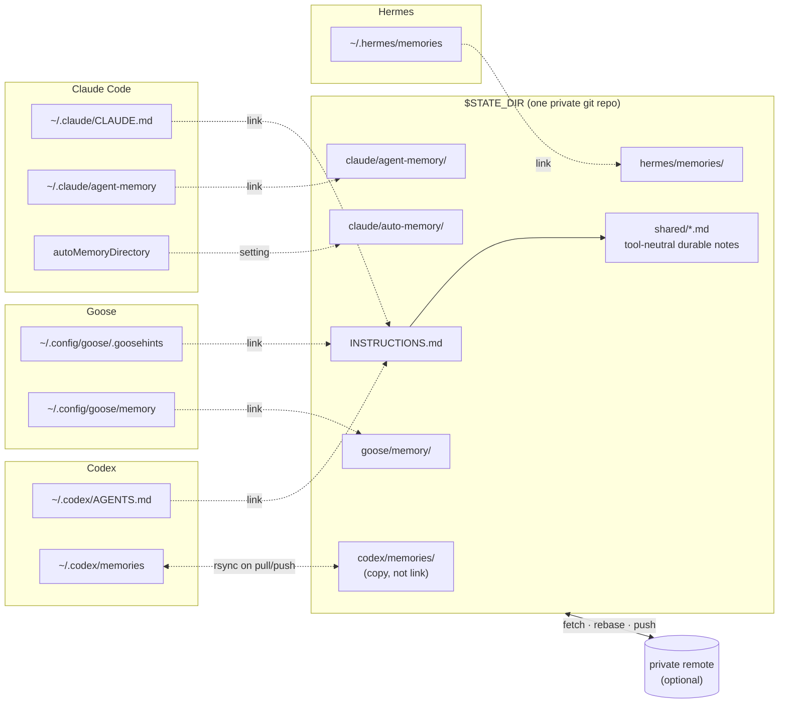
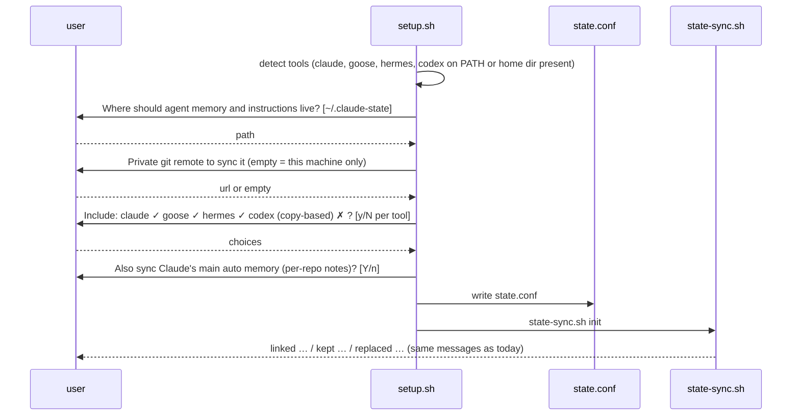

# Phase 5 plan — one memory store, chosen at setup, shared across tools

**Date:** 2026-10-09 · **Base:** `cd8c1d7` (plugin 0.5.0) · **Target:** plugin 0.6.0

> **Status: implemented** (branch `phase-5`, 2026-10-09, plugin 0.6.0). User's answers:
> U1 yes (one shared `INSTRUCTIONS.md`), U2 no (Codex memory not synced; Codex still
> gets the shared instructions link), U3 yes (Claude auto memory), U4 default
> `~/.agent-state` with an existing `~/.claude-state` migrated. Deviations:
>
> - Tracks A–C landed as one commit: they are one rewrite of `state-sync.sh`, now a
>   core script plus a sourced `claude/scripts/state-items.sh` (320 + 256 lines).
> - D6 as amended in §3.2: per-project auto memory is linked directory by directory,
>   not through `autoMemoryDirectory` (which is a single directory, not a base).
> - Codex copy-based sync (D3) was not built, since U2 = no; the items table has no
>   `copy` method. Adding it later is one row plus a `copy` branch in `adopt`.
> - `setup.sh` is at 558 lines, over the 400-line convention; it was 445 before and
>   is one flat script by design. Splitting it is a separate cleanup.
> - Red-phase tests were written by a separate agent; an independent review followed
>   and its confirmed findings (a `~` store path stored verbatim, phase-4 devices
>   silently off after upgrading, a store moved before a refused `init`, lost edits
>   when two instruction files changed while off, a setup re-run ignoring
>   `state.conf`, an untracked file skipped by the layout conversion, `off` limited
>   to the listed tools and blind to the old layout, an unrebased first push, a
>   commit during another sync's rebase) were fixed with red-phase tests first
>   (420 checks in the two suites). Left as documented limits: `python3` is required
>   for path resolution, and a later device gets the repo's instruction file with its
>   own copy backed up rather than folded in.

Today `state-sync.sh` syncs two Claude Code items into a directory fixed at
`~/.claude-state`. This phase makes the location a setup-time choice, extends the
store to Goose, Hermes and Codex, and gives every tool one shared instruction file and
one shared notes folder — the only form of "agnostic" memory that holds up, because no
tool reads another tool's memory format.



---

## 1. Facts this design relies on

Verified 2026-10-09 from the tools' documentation and source (links in §9).

| # | Tool | Memory on disk | Instructions on disk | Relocation |
|---|------|----------------|----------------------|------------|
| 1 | Claude Code 2.1.295 | `~/.claude/agent-memory/<agent>/MEMORY.md` (subagents, `memory: user`); `~/.claude/projects/<repo>/memory/` (the main assistant's auto memory, keyed by git repo) | `~/.claude/CLAUDE.md` | `CLAUDE_CONFIG_DIR` moves everything; `autoMemoryDirectory` (settings, any scope) moves only auto memory. Symlinked `agent-memory/` works in the CLI (phase 4); Cowork skips a symlinked `CLAUDE.md`. |
| 2 | Goose | `~/.config/goose/memory/<category>.txt` — plain text, one entry per paragraph, optional `# tag` line; **not** Markdown | `~/.config/goose/.goosehints` (also reads `AGENTS.md`) | `GOOSE_PATH_ROOT` moves config/data/state together; no per-item key. |
| 3 | Hermes | `~/.hermes/memories/MEMORY.md` (≤ 2 200 chars) and `USER.md` (≤ 1 375 chars) — limits are enforced, an oversized write errors | `~/.hermes/SOUL.md` (identity, not instructions); project files `AGENTS.md` / `CLAUDE.md` are auto-injected | `HERMES_HOME` env var only. |
| 4 | Codex | `~/.codex/memories/` — Markdown (`MEMORY.md`, `raw_memories.md`, `rollout_summaries/`), **with its own `.git` inside**; feature off by default, unavailable in the EEA/UK/CH | `~/.codex/AGENTS.md` (or `AGENTS.override.md`) | `CODEX_HOME` moves all state; the directory must already exist. |
| 5 | Claude Code | Settings `env` values reach hook processes and Bash-tool commands. | | |
| 6 | git | A directory containing its own `.git` cannot be tracked by an enclosing repo (it becomes an untracked gitlink). Codex memories therefore cannot be symlinked into the state repo. | | |

---

## 2. Goals and non-goals

| | Goal | Track |
|---|------|-------|
| G1 | `setup.sh` asks where the store lives and which remote (if any) syncs it; the answer is written once and read by the hooks and the `/sync-state` command alike | A, D |
| G2 | Goose and Hermes memory and the three user-level instruction files follow the user like Claude's memory does | B, C |
| G3 | Codex memory follows too, by copy, when the user opts in | B |
| G4 | One instruction file and one notes folder that every tool reads and writes — the shared layer | C |
| G5 | Claude's main-assistant auto memory is included when the user wants it | B |

**Non-goals.** Translating one tool's memory into another's (formats and semantics
differ; the shared notes folder is the bridge). Syncing settings, sessions, credentials,
`state.db`, SQLite files. Moving a tool's *home* directory (`GOOSE_PATH_ROOT`,
`HERMES_HOME`, `CODEX_HOME` stay the user's business). Windows.

---

## 3. Design

### 3.1 One config file, read by everything (Track A)

`~/.config/agent-recipes/state.conf` — plain `KEY=VALUE`, sourced by Bash, written by
`setup.sh` or `state-sync.sh config`:

```sh
STATE_DIR=/Users/w/Sync/agent-state      # default ~/.claude-state
STATE_REMOTE=git@github.com:w/claude-state.git   # empty = local-only (history, no push)
STATE_TOOLS="claude goose hermes"       # detected at setup; codex only when opted in
STATE_CLAUDE_AUTO_MEMORY=yes            # G5
```

Precedence in `state-sync.sh`: `STATE_SYNC_DIR` env (tests) → config file → default.
This replaces phase 4's "fixed directory" decision (D9) without reopening its reason:
the hooks and the command read the same file, so they cannot disagree.

### 3.2 Items table instead of two hard-coded lists (Track B)

```sh
# tool  kind  method  native path                     repo path
claude  dir   link    $CLAUDE_HOME/agent-memory        claude/agent-memory
claude  file  link    $CLAUDE_HOME/CLAUDE.md           INSTRUCTIONS.md
claude  dir   setting -                                claude/auto-memory   # autoMemoryDirectory
goose   dir   link    ~/.config/goose/memory           goose/memory
goose   file  link    ~/.config/goose/.goosehints      INSTRUCTIONS.md
hermes  dir   link    ~/.hermes/memories               hermes/memories
codex   file  link    ~/.codex/AGENTS.md               INSTRUCTIONS.md
codex   dir   copy    ~/.codex/memories                codex/memories
```

- `link` is today's adopt-and-symlink (phase 4, including the foreign-symlink copy).
- `copy` is for Codex: `pull` copies repo → native when the repo side is newer,
  `push` copies native → repo (excluding `.git`); last writer wins; said so in `status`.
- `scan` (Claude auto memory): `autoMemoryDirectory` turned out to be the memory
  directory itself, not a base — at user scope it would pour every project's notes into
  one folder. So `init`, `pull` and `push` scan `$CLAUDE_HOME/projects/*/memory/` and
  adopt-and-link each one into `claude/auto-memory/<project>/`; a project that appears
  later is picked up at the next session start. Transcripts next to it are never
  touched. The `<project>` key is the encoded working-directory path, so it lines up
  across devices that keep repos at the same paths.
- `.gitattributes` gains `*.txt merge=union` (Goose) next to `*.md merge=union`.
- A tool section is active only when listed in `STATE_TOOLS`; a tool absent on one
  device is simply not linked there, its folder in the repo rides along untouched.
- Hermes limits: `status` warns when `MEMORY.md` or `USER.md` exceeds the cap after a
  union merge, since Hermes' next write would fail.

### 3.3 The shared layer (Track C)

- `INSTRUCTIONS.md` is the one user-level instruction file. On `init` it is built from
  the existing files: `~/.claude/CLAUDE.md` becomes the body; a differing
  `~/.codex/AGENTS.md` or `.goosehints` is appended under a `## From <tool>` heading;
  originals go to the backup directory. Each tool's native file becomes a link to it.
  Hermes keeps `SOUL.md` (it is an identity file, not instructions); Hermes picks up
  `INSTRUCTIONS.md` through its `AGENTS.md`/`CLAUDE.md` project injection only if the
  user links one of those in a project — documented, not automated.
- `shared/` holds tool-neutral durable notes (`shared/README.md` explains the
  convention). `INSTRUCTIONS.md` gets a fixed paragraph telling the model: read
  `shared/*.md` at the start of a task that needs context about the user's work; write a
  new durable fact there as a short Markdown file; never store secrets there. That is
  the whole "agnostic memory" mechanism, and it works because all four tools obey
  their instruction file.

### 3.4 Setup (Track D)

`setup.sh` gains `--state`, `--state-dir <path>`, `--state-remote <url>`,
`--state-tools <list>`, `--no-state`. With `--all` or `--state` on a terminal and no
flags, it asks:



Non-interactive (`! -t 0`, CI) uses the defaults and never prompts; `--dry-run` prints
the config it would write and the items it would link; `--uninstall` runs
`state-sync.sh off` first and removes `state.conf`.

The plugin path: `/sync-state config dir=… remote=… tools=…` writes the same file for
users who never run `setup.sh`; `/sync-state init` with no URL reads it.

---

## 4. Decisions

### 4.1 Decided (recommended defaults)

| # | Decision | Why | Rejected |
|---|----------|-----|----------|
| D1 | The location is a config file, not a plugin option and not an env var in settings. | Hooks, the command and `setup.sh` (which does not run inside Claude Code) all read it; plugin options never reach Bash-tool commands (phase 4 fact 3). | Settings `env` (Claude-only); `GOOSE_PATH_ROOT`-style home moves (too invasive). |
| D2 | Local-only is a first-class mode: no remote means commit-only, with history. | A single-machine user still gains versioning and rollback. | Requiring a remote. |
| D3 | Codex is copy-based and off unless chosen. | Its store has a nested `.git` (fact 6) and the feature is region-gated and off by default. | Symlink (impossible); skipping Codex entirely. |
| D4 | One `INSTRUCTIONS.md` for Claude, Goose and Codex; Hermes keeps `SOUL.md`. | The three read plain instruction files with the same intent; Hermes' file is a persona. | Per-tool instruction files synced separately (three copies of the same preferences drift). |
| D5 | Shared knowledge is a Markdown folder plus an instruction paragraph, not a converter. | Memory formats differ (Goose plain text with tags, Hermes two capped files, Claude per-agent trees); the only thing all tools share is "follow the instruction file". | Converting memories between formats. |
| D6 | Claude's auto memory joins by linking each `projects/<project>/memory/` directory, default yes. | It is the richest store on this machine (720 KB for one project). `autoMemoryDirectory` is a single directory, not a base (docs), so it cannot keep projects apart at user scope. | `autoMemoryDirectory` at user scope (merges all projects); symlinking `~/.claude/projects` (drags transcripts along). |

### 4.2 Needs the user

| # | Question | Default if unanswered |
|---|----------|----------------------|
| U1 | Should `INSTRUCTIONS.md` **replace** your per-tool instruction files (one shared file, D4), or should each tool's file be synced as-is under its own name? | Replace (D4). |
| U2 | Include Codex memory (copy-based, last writer wins)? You have `~/.codex` but memories are not enabled there today. | No. |
| U3 | Include Claude's main auto memory (D6)? Works best when the same repos live at the same paths on each device, which your `Sync/` layout suggests. | Yes. |
| U4 | Default store location: keep `~/.claude-state`, or something tool-neutral such as `~/.agent-state`? Existing phase 4 users would be migrated by `init` (move + relink). | `~/.agent-state` for new installs; existing `~/.claude-state` is detected and kept. |

---

## 5. Tracks

| Track | Files | Tests (written first, by a different agent) |
|-------|-------|---------------------------------------------|
| A — config | `claude/scripts/state-sync.sh` (`load_config`, `cmd_config`), `claude/commands/sync-state.md` | `tests/test_state_sync.sh`: precedence env → file → default; `config` round-trip; local-only `push` commits and never fetches |
| B — items | `state-sync.sh` (items table, `copy` method, `setting` method, `*.txt` union, Hermes cap warning), `.gitattributes` | `tests/test_state_sync.sh`: Goose dir linked, two devices keep both category entries; Hermes files linked, cap warning; Codex copy both ways, last writer wins; `autoMemoryDirectory` set on init, removed on off; a tool missing on one device |
| C — shared layer | `state-sync.sh` (`build_instructions`, `shared/README.md` template), `docs/` | `tests/test_state_sync.sh`: `INSTRUCTIONS.md` assembled from three differing files with backups; links in place for the tools listed; `shared/README.md` present; the instruction paragraph present exactly once |
| D — setup | `setup.sh` (flags, prompts, detection, dry-run, uninstall) | new `tests/test_setup_state.sh`: non-interactive defaults; flags override; prompts answered through stdin; dry-run writes nothing; uninstall runs `off` and removes the file |
| E — docs | `docs/TUTORIAL-notifications-sync.md` §4, `README.md` Sync section, `claude/README.md`, this plan's status | `tools/check_manifests.py` unchanged; `--base cd8c1d7` requires the version bump |

Order A → B → C → D → E; one commit per track; `claude/CONVENTIONS.md` applies
(≤ 400 lines per file: `state-sync.sh` is at 280, Track B likely splits the items
logic into `claude/scripts/state-items.sh`, sourced).

---

## 6. Migration for existing phase 4 users

`init` finds `~/.claude-state` with the old layout (`agent-memory/`, `CLAUDE.md` at the
root), moves them to `claude/agent-memory/` and `INSTRUCTIONS.md` in one commit,
relinks, and — if `STATE_DIR` differs — moves the whole repo and relinks again. `off`
keeps working on either layout.

---

## 7. Security and risk

| Risk | Mitigation |
|------|------------|
| The store now carries Hermes `USER.md` (a profile of the user) and Codex rollout summaries. | Same rule as phase 4: private remote, the hold-back patterns, and `status` lists what is tracked. The tutorial names these two files explicitly. |
| A shared `INSTRUCTIONS.md` is read by four tools: an instruction written for one may misfire in another. | Tool-specific lines live under `## Claude Code` / `## Goose` / `## Codex` headings that the paragraph tells other tools to skip. |
| Union merge pushes a Hermes file over its character cap. | `status` warns; `pull` trims nothing (never silently drop memory); the user edits. |
| Codex copy mode loses an edit when two devices write between syncs. | Documented as last-writer-wins; off by default. |
| `autoMemoryDirectory` set by `init` and left behind if the user deletes the store by hand. | `status` reports a dangling setting; `off` removes it. |

---

## 8. Definition of done

Phase 4's §11 list, plus `tests/test_setup_state.sh`, `plugin.json` at 0.6.0, the
tutorial's §4 rewritten for the multi-tool layout, and one real-machine check: Goose's
memory extension writes through the link (`goose session` → `remember_memory`, then a
commit appears at session end).

## 9. References

- Claude Code — [memory](https://code.claude.com/docs/en/memory) · [claude directory](https://code.claude.com/docs/en/claude-directory) · [settings `env`](https://code.claude.com/docs/en/settings-reference#env) · [subagents](https://code.claude.com/docs/en/sub-agents)
- Goose — [memory extension](https://goose-docs.ai/docs/mcp/memory-mcp) · [goosehints](https://github.com/block/goose/blob/main/documentation/docs/guides/context-engineering/using-goosehints.md) · [paths.rs](https://github.com/block/goose/blob/main/crates/goose/src/config/paths.rs)
- Hermes — [memory](https://hermes-agent.nousresearch.com/docs/user-guide/features/memory) · [configuration](https://hermes-agent.nousresearch.com/docs/user-guide/configuration/)
- Codex — [memories](https://learn.chatgpt.com/docs/customization/memories) · [AGENTS.md](https://learn.chatgpt.com/docs/agent-configuration/agents-md) · [environment variables](https://learn.chatgpt.com/docs/config-file/environment-variables)
- In this repo — `docs/phase-4-plan.md` (D9–D12), `claude/scripts/state-sync.sh`
