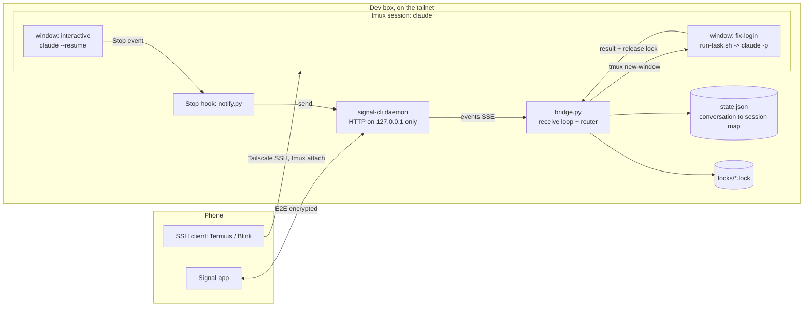
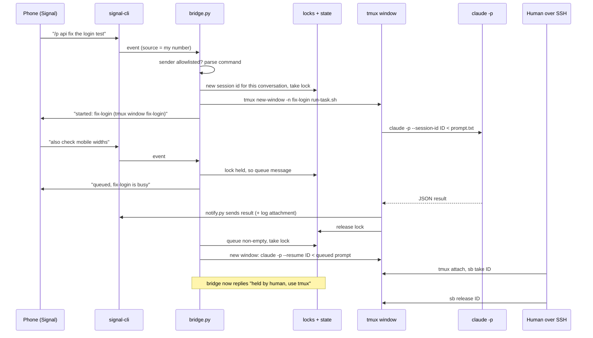
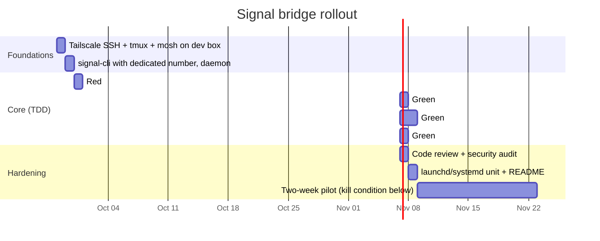

# Plan: Signal Bridge + Tailscale/tmux for Claude Code

> Goal: drive Claude Code from Signal on the phone (fire-and-forget tasks, completion
> notifications) while every task stays attachable over Tailscale + tmux for hands-on
> takeover. Stdlib-only Python, no public ports, never `bypassPermissions`.

## Guiding principles

1. **tmux is the runtime, Signal is the remote.** The bridge never runs Claude in a
   hidden background process — every task gets a named tmux window you can attach to.
2. **One writer per session.** A Claude session is resumed by at most one process at a
   time (bridge *or* human), enforced by a per-session lock.
3. **Messages are untrusted input to a code-executing agent.** Sender allowlist, no
   shell interpolation of message text, `auto` permission mode, guard hook on.
4. **Stdlib only.** Matches `claude/hooks/guard.py`; nothing to `pip install` on the box.

## Architecture

## Components

All new files live under `claude/signal-bridge/`.

| File | Responsibility |
| --- | --- |
| `bridge.py` | Subscribes to signal-cli events, drops non-allowlisted senders, parses commands, routes to sessions, enqueues when busy. |
| `sessions.py` | Conversation to session-ID map (`state.json`, atomic write via temp file + `os.replace`) and per-session locks (`O_CREAT\|O_EXCL` lock file holding owner + pid; stale if the pid is dead). |
| `launcher.py` | Writes the prompt to a file, opens `tmux new-window -n <sanitized-name> run-task.sh <task-dir>` — argv only, message text never enters a shell string. |
| `run-task.sh` | Runs in the tmux window: `claude -p --session-id/--resume <id> --permission-mode auto --output-format json < prompt.txt`, tees to a log, then calls `notify.py` and releases the lock. Sets `SIGNAL_BRIDGE_TASK=1`. |
| `notify.py` | Sends a reply via signal-cli: truncates to N chars and attaches the full log as a file when longer. Also the **Stop hook** for interactive sessions — skips when `SIGNAL_BRIDGE_TASK=1` so bridge tasks don't notify twice. |
| `sb` | Small CLI for the tmux side: `sb take <session>`, `sb release <session>`, `sb status`. |
| `config.example.json` | `account`, `allowed_senders`, `projects` (name to dir), `max_reply_chars`, `signal_cli_url`. Real config lives at `~/.config/signal-bridge/config.json` (never in the repo). |
| `README.md` | Setup: signal-cli registration, Tailscale SSH, tmux, launchd/systemd unit, Stop-hook install. |

## Message flow

## Signal commands

| Message | Effect |
| --- | --- |
| plain text | Continue this conversation's current session (queued if busy). |
| `/p <project> <text>` | New session in an allowlisted project dir. Unknown project names are rejected — no free-form paths. |
| `/new <text>` | New session in the conversation's current project. |
| `/status` | Running, queued, and human-held sessions with their tmux window names. |
| `/stop` | Send `C-c` to the task's tmux window and release its lock. |

## Security model

| Threat | Control |
| --- | --- |
| Stranger messages the bot number | `allowed_senders` checked on the source number **and** UUID; everything else is dropped silently and logged. |
| Message text becomes shell code | Prompt written to a file and fed via stdin; tmux window names restricted to `[a-z0-9-]{1,30}`; no `shell=True`, no `tmux send-keys` with message text. |
| Prompt injection via web/email content the agent reads | `--permission-mode auto` (classifier) + existing `guard.sh` PreToolUse hook; bridge refuses to start if config asks for `bypassPermissions`. |
| Arbitrary working directory | Only `projects` entries from config; no paths in messages. |
| signal-cli API exposed | Daemon bound to `127.0.0.1`; dev box reached only via Tailscale; no open inbound ports. |
| Secrets in replies | `notify.py` caps size; logs stay on the box; replies are E2E encrypted by Signal. |
| Linked-device sync messages | Use a **dedicated bot number** (also avoids linking an unofficial client to your personal account). |

## Testing (TDD per repo rules)

- **Framework:** stdlib `unittest` in `tests/test_signal_bridge.py`, wired into CI next to the existing bash tests.
- **Fakes, no network:** a fake signal-cli (local `http.server` serving scripted events and recording sends), a fake `claude` binary on `PATH` that echoes canned JSON, and a fake `tmux` that records argv and runs the command inline.
- **Contract cases:**
  - non-allowlisted sender produces no tmux call
  - shell metacharacters in a message never reach argv as code
  - busy session queues and drains in order
  - a stale lock from a dead pid is reclaimed
  - `sb take` blocks the bridge
  - unknown `/p` project is rejected
  - `bypassPermissions` config refuses to start
  - long reply is truncated with an attachment
  - Stop hook skips when `SIGNAL_BRIDGE_TASK=1`
- **Pipeline:** `test-architect` (red) → `python-expert` (green, may not touch tests) → `code-reviewer` + `security-auditor` (remote-execution surface).

## Phases

**Kill condition:** if after the two-week pilot fewer than ~5 tasks/week start from Signal, keep only the Stop-hook notifier (tmux + Signal pings) and drop the inbound bridge.

## Open questions

1. **Which machine is the dev box** (this Mac or a Linux server)? This decides between a launchd and a systemd unit, and whether the box sleeps.
2. **Dedicated number or linked device?** The plan assumes a dedicated number.
3. **Project allowlist:** which directories should `/p` expose on day one?
